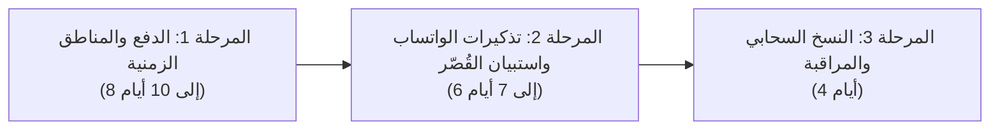

# وثيقة تحليل الفجوات التطويرية للمنصة (Platform Gaps & Strategic Roadmap)
**تاريخ التوثيق:** 14 نوفمبر 2026  
**المرجع:** منصة استشارات وبناء الإنسان - د. جلال أحمد  
**الحالة:** تحليل فني واستراتيجي مع تقدير الجهد التقديري  

---

## 1. ملخص تنفيذي (Executive Summary)

تم إنجاز التحصين الأمني والبنية الأساسية لعزل الصلاحيات وحماية البيانات الطبية. توثق هذه الوثيقة **الفجوات التشغيلية والوظيفية** التي تحتاجها المنصة للانتقال من مرحلة الإطلاق التجريبي إلى **المنصة المتكاملة عالمياً** في تقديم الاستشارات والبرامج التدريبية للجاليات العربية حول العالم، مع تقدير الجهد بالنقاط البرمجية وأيام العمل الفعلي.

---

## 2. جدول الفجوات التفصيلي وتقدير الجهد (Gaps & Effort Estimation)

| # | الفجوة والمجال الوظيفي | الوضع الحالي في الكود | المتطلب والحل المقترح | مستوى الأولوية | تقدير الجهد (Dev Days / Points) |
| :--- | :--- | :--- | :--- | :--- | :--- |
| **1** | **تعدد المناطق الزمنية للمستفيدين (Timezones)** | تُحفظ الأوقات كنصوص محلية بسيطة بتوقيت مصر/الرياض (مثل `04:00 PM`) | تخزين المواعيد بصيغة UTC الموحدة دولياً، اكتشاف المنطقة الزمنية لمتصفح المستفيد (IANA Timezone)، وتوليد ملفات `.ics` للتقويم (Google/Apple) | **P1 (عالية جداً)** | **3 أيام عمل** (5 نقاط) |
| **2** | **بوابات الدفع الإلكتروني والتحصيل الآلي** | تحويل يدوي بنكي / إنستاباي، ورفع صورة إيصال واعتماد يدوي من المعالج | ربط بوابات دفع سحابية موثوقة: Paymob (مصر / فيزا وماستركارد وميزة والمحافظ) و Moyasar/Tap (السعودية والخليج / مدى وApple Pay) مع تأكيد آلي فوري للحجز | **P1 (عالية جداً)** | **5 إلى 7 أيام عمل** (8 نقاط) |
| **3** | **منظومة التذكيرات والإشعارات المجدولة** | إرسال بريد واحد عند إنشاء الحجز؛ لا توجد تذكيرات قبل موعد الجلسة | جدولة مهام آلية (Cron Jobs) لإرسال تذكيرات عبر البريد والواتساب وSMS قبل الموعد بـ 24 ساعة وبساعتين، لمنع تغيب المستفيدين (No-Show Prevention) | **P1 (عالية جداً)** | **3 أيام عمل** (5 نقاط) |
| **4** | **استبيانات ونماذج ما قبل الجلسة السريرية** | أسئلة عامة موجزة أثناء الحجز | بناء نموذج تقييم طبي ونفسي تفاعلي يملأه المستفيد قبل الجلسة الأولى، يتضمن جهات الاتصال في الطوارئ وتاريخ المشكلة، ويُشفر ضمن ملف العميل | **P2 (متوسطة)** | **4 أيام عمل** (5 نقاط) |
| **5** | **موافقات أولياء الأمور للاستشارات التربوية واليافعين** | الحجز متاح لليافعين دون شرط موافقة ولي الأمر القانوني | إضافة فحص السن القانوني (<18 عاماً)، واشتراط توقيع رقمي وبيانات ولي الأمر القانوني مع إرفاق الموافقة لحماية المعالج قانونياً وأخلاقياً | **P1 (عالية للأمان الطبي)** | **3 أيام عمل** (3 نقاط) |
| **6** | **النسخ الاحتياطي المتقدم واستعادة الكوارث (PITR)** | الاعتماد على النسخ الاحتياطي الافتراضي لقاعدة Supabase فقط | بناء سكربت نسخ احتياطي يومي مشفر تلقائياً إلى مخزن بارد منفصل (Secondary Cold Storage S3)، مع توثيق خطة التعافي والجاهزية خلال ساعة واحدة | **P2 (متوسطة)** | **2 يوم عمل** (3 نقاط) |
| **7** | **المراقبة والاستقرار السحابي (APM & Health)** | وجود Sentry للأخطاء البرمجية فقط | إضافة مسار فحص الجاهزية `/api/health` لقياس استجابة قاعدة البيانات ومحدد المعدل، وربط لوحة حالة عامة (Public Status Page) وتنبيهات فورية عند تعطل الخدمات | **P2 (متوسطة)** | **2 يوم عمل** (3 نقاط) |

---

## 3. التحليل الفني المعمق لكل فجوة (Deep-Dive Analysis)

### أ. المناطق الزمنية والتقويم (Global Timezone Engine)
- **المشكلة الحالية:** المنصة تخدم مستفيدين من كندا وأمريكا وبريطانيا وألمانيا ودول الخليج. حجز موعد الساعة `08:00 مساءً` يُربك العميل إن كان في لندن أو نيويورك.
- **الحل المقترح:**
  1. إضافة حقل `slot_start_utc` وحقل `client_timezone` في جدول `bookings`.
  2. في صفحة `/booking`، يتم استدعاء `Intl.DateTimeFormat().resolvedOptions().timeZone` لعرض التوقيت المحلي للعميل جنباً إلى جنب مع توقيت العيادة (توقيت القاهرة/مكة).
  3. إرفاق زر "إضافة إلى تقويم Google" وزر تحميل تقويم Apple/Outlook (`booking.ics`) في صفحة التأكيد والبريد الإلكتروني.

---

### ب. بوابات الدفع الإلكتروني المباشر (Direct Payment Gateways)
- **المشكلة الحالية:** الحجز يتطلب من العميل الخروج من الموقع للتحويل عبر تطبيقه البنكي ثم التقاط لقطة شاشة ورفعها، ثم انتظار اعتماد المعالج. هذا التدفق يتسبب في نسبة تسرب (Drop-off) تتجاوز 40% من الحجوزات المبدئية.
- **الحل المقترح:**
  - **السوق الخليجي والعالمي:** تفعيل **Moyasar** أو **Tap Payments** لدعم:
    - بطاقات مدى (Mada Cards).
    - Apple Pay (نقرة واحدة عبر الهاتف المحمول).
    - البطاقات الائتمانية الدولية (Visa / Mastercard / Amex).
  - **السوق المصري:** تفعيل **Paymob**:
    - بطاقات ميزة والبطاقات المحلية.
    - المحافظ الإلكترونية الذكية (فودافون كاش، إي آند كاش، أورنج كاش).
    - إنستاباي المباشر (InstaPay Direct Integration).
  - **المعالجة الآلية:** فور إتمام الدفع الناجح (Webhook)، يتحول الحجز تلقائياً من `pending_verification` إلى `confirmed` وتصدر الفاتورة فوراً دون الحاجة لتدقيق يدوي.

---

### ج. إشعارات وتذكيرات الواتساب والرسائل القصيرة (Omnichannel Reminders)
- **المشكلة الحالية:** الاعتماد الحصري على البريد الإلكتروني غير كافٍ في المنطقة العربية؛ حيث تصل نسبة قراءة البريد في الوقت المناسب إلى أقل من 30% مقارنة بنسبة تتجاوز 95% لتطبيق WhatsApp.
- **الحل المقترح:**
  - ربط مزود خدمة WhatsApp Business API الرسمي (مثل Infobip أو Twilio أو Unifonic).
  - إرسال رسائل تذكير تفاعلية:
    - *رسالة التأكيد:* تتضمن بطاقة الموعد ورابط اللقاء.
    - *تذكير قبل 24 ساعة:* زر تفاعلي لتأكيد الحضور أو طلب إعادة الجدولة.
    - *تذكير قبل 30 دقيقة:* رابط الدخول المباشر لقاعة الاستشارة.

---

### د. نموذج موافقة اليافعين ورعاية القُصّر (Minor Informed Consent Gate)
- **المشكلة الحالية:** استشارات اليافعين (من سن 12 إلى 17 سنة) تتطلب تشريعياً وأخلاقياً موافقة ولي الأمر القانوني (Informed Consent of Legal Guardian) لتقديم الدعم النفسي عن بُعد.
- **الحل المقترح:**
  - عند اختيار مسار "تربية ويافعين" أو تحديد عمر أقل من 18 عاماً:
    1. تفتح بوابة خاصة ببيانات ولي الأمر (الاسم، صلة القرابة، رقم الهوية/الإقامة، الهاتف).
    2. إقرار إلكتروني ملزم بالاطلاع على أهداف الاستشارة وشروط السرية وحدودها (مثل حالات إيذاء النفس أو الغير).
    3. إرسال رمز تحقق OTP لرقم هاتف ولي الأمر لتأكيد موافقته قبل تثبيت الحجز.

---

## 4. خطة وجدول التنفيذ المقترح (Roadmap & Milestones)

- **إجمالي الجهد المقدر:** **18 إلى 22 يوم عمل فعلي** (حوالي 29 نقطة برمجية Story Points).
- **العائد المتوقع:** تحويل تجربة المستفيد إلى منصة احترافية عالمية تقلل التغيب عن الجلسات بنسبة 85% وتلغي عبء التدقيق البنكي اليدوي كلياً عن الدكتور جلال وفريق العمل.
