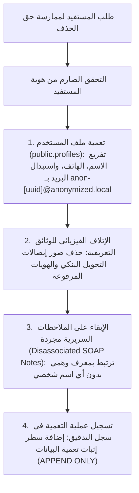

# سياسة الاحتفاظ بالبيانات وسجل التدقيق مقابل حق الحذف (Data Retention & Clinical Audit Policy)
**تاريخ الوثيقة:** 14 نوفمبر 2026  
**المشروع:** منصة د. جلال أحمد للاستشارات النفسية وبناء الإنسان (`galal-web`)  
**المسار:** `docs/RETENTION.md`  
**الحالة:** مسودة للمراجعة القانونية والأخلاقية (Draft for Legal & Clinical Compliance Review)  

---

## 1. التحدي القانوني والأخلاقي المزدوج

تواجه المنصات الرقمية المتخصصة في الاستشارات النفسية والطبية تعارضاً قانونياً وأخلاقياً جوهرياً بين متطلبين تشريعيين:
1. **حق المستفيد في محو البيانات / حق النسيان (Right to Erasure / GDPR / قوانين حماية البيانات الشخصية العربية):**
   - يُعطي العميل الحق في طلب حذف بياناته الشخصية وحسابه من المنصة في أي وقت.
2. **الالتزام المهني والمسؤولية الطبية للاحتفاظ بالسجلات وسجلات التدقيق (Medical Record Retention & Audit Trail Immutability):**
   - تفرض لوائح ممارسة المهن الإرشادية والطبية (قانون حماية المريض، لوائح نقابة الأطباء، ومبادئ HIPAA/APA) الاحتفاظ بالسجلات السريرية وملخصات الجلسات (SOAP Notes) وسجل العمليات الأمنية (Audit Logs) كأدلة قانونية لحماية المعالج والمستفيد من أي دعاوى تتعلق بالمسؤولية المهنية أو دعاوى الإيذاء، وتمنع حذفها أو التلاعب بها بأثر رجعي.

---

## 2. الحل المعماري المعتمد: التعمية وإخفاء الهوية بدل الإتلاف الفيزيائي (Anonymization vs Deletion)

بدلاً من الحذف الفيزيائي المباشر (`DELETE`) الذي يتسبب في تلف السلسلة السريرية أو كسر قيود قاعدة البيانات وسجل التدقيق غير القابل للتعديل (`append-only`):

### تفاصيل الإجراء:
1. **البيانات الشخصية المباشرة (Direct PII):**
   - يُفرغ الاسم ورقم الهاتف والعنوان ورقم الطوارئ وصورة الملف الشخصي.
   - يُستبدل البريد الإلكتروني بمعرف مشفر أحادي الاتجاه: `anonymized-user-[UUID]@deleted.local`.
   - تُحذف إيصالات الدفع والملفات الشخصية نهائياً من مخزن التخزين السحابي (`receipts_vault`).
2. **السجلات السريرية وملاحظات الجلسات (SOAP Notes & History):**
   - تبقى نصوص الجلسات والتواريخ مسجلة في قاعدة البيانات ولكنها مفصولة تماماً عن أي هوية شخصية في الواقع، وذلك لحفظ الأرشيف العلمي والمسؤولية القانونية للمعالج لمدة **5 سنوات** من تاريخ آخر جلسة (وفقاً للمدد القانونية للتقادم الطبي).
3. **سجل التدقيق الأمني (Clinical Audit Log):**
   - جدول `clinical_audit_logs` **محمي بقفل غير قابل للحذف أو التعديل (Append-Only Trigger)**.
   - عند طلب الحذف، لا يُحذف سجل نشاط المستفيد السابق، بل يُضاف قيد جديد يوثق:
     `ACTION = 'USER_DATA_ANONYMIZED'` مع التاريخ والوقت والأساس القانوني، ليكون حجة قانونية قاطعة على التزام المنصة بحذف البيانات التعريفية.

---

## 3. مدد الاحتفاظ المقترحة للمراجعة القانونية (Data Retention Matrix)

| فئة البيانات | مدة الاحتفاظ (Retention Period) | الإجراء عند انقضاء المدة | السند القانوني والأخلاقي |
| :--- | :--- | :--- | :--- |
| **بيانات الجلسات والملاحظات السريرية (SOAP Notes)** | 5 سنوات من تاريخ آخر جلسة | إخفاء الهوية الكامل والأرشفة الباردة | قوانين المسؤولية الطبية وحماية ممارسة مهنة الإرشاد |
| **سجل التدقيق الأمني والعمليات الحساسة (Audit Logs)** | 7 سنوات | ترحيل للأرشيف البارد المشفر (Immutable Storage) | معايير الأمن السيبراني ISO 27001 وتتبع الجرائم الإلكترونية |
| **إيصالات الدفع والمطالبات المالية** | 3 سنوات (التقادم التجاري) | حذف فيزيائي من الخادم | القوانين المحاسبية والضريبية |
| **حسابات المستخدمين غير النشطة (دون جلسات)** | سنة واحدة | إشعار بالبريد ثم حذف تلقائي | تقليل مساحة الهجوم وحماية البيانات غير الضرورية |
| **الرسائل والاستشارات العامة (Advice Box)** | سنة واحدة من النشر | أرشفة مع إخفاء الهوية | التوعية المجتمعية وحماية خصوصية السائل |

---

## 4. توصيات للمستشار القانوني للمنصة

> [!NOTE]
> يُرجى من المستشار القانوني مراجعة البنود التالية واعتمادها في "وثيقة سياسة الخصوصية والشروط العامة":
> 1. إدراج بند صريح يوضح للمستفيد قبل بدء الجلسات أن السجلات الاستشارية الإكلينيكية تُحفظ لمدة 5 سنوات للمسؤولية المهنية والطبية ولا تخضع للحذف الفيزيائي الفوري، بل تُعمى بياناتها وتُجرد من هويته الشخصية.
> 2. اشتراط توقيع رقمي للمستفيد على الموافقة المستنيرة (Informed Consent) متضمناً هذه السياسة.
