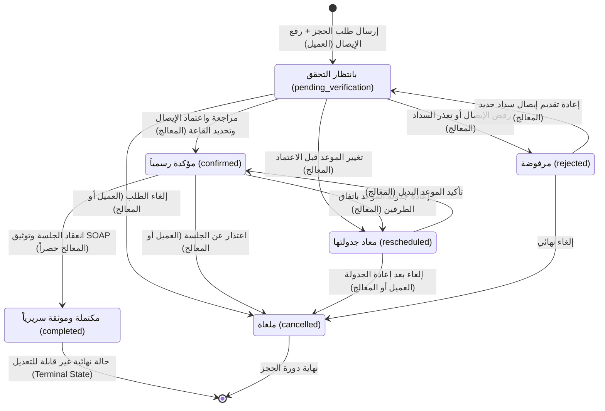
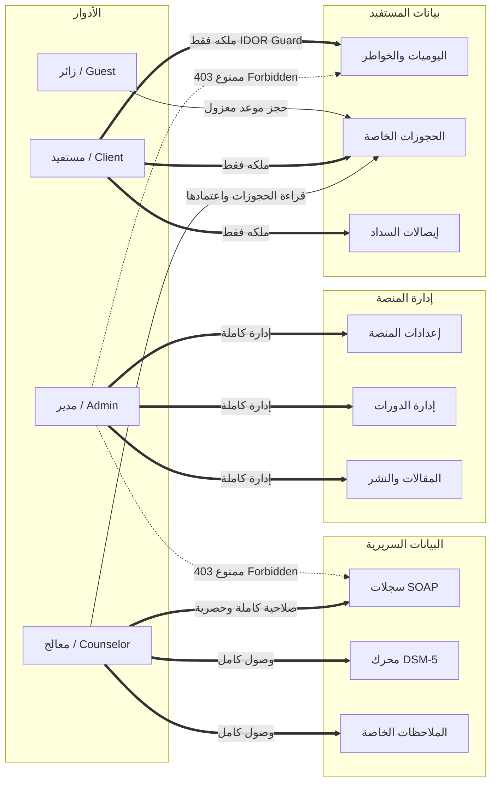
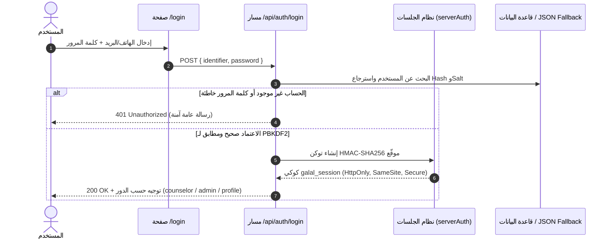
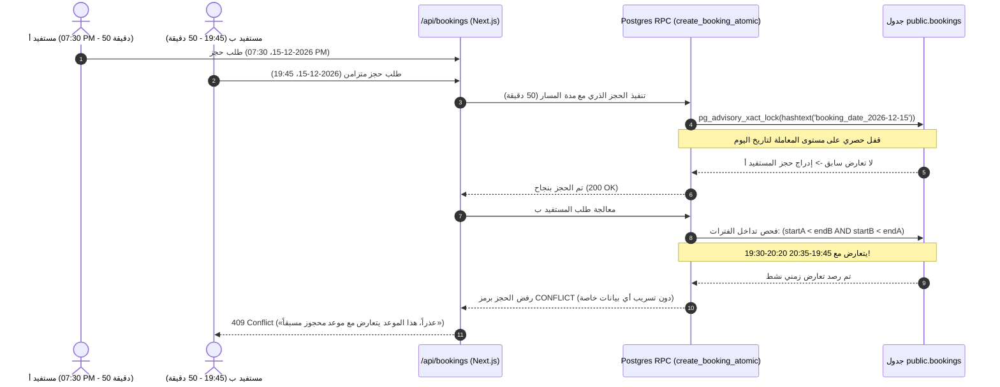

# المعمارية الأمنية وإدارة دورة حياة الحجوزات
## Security Architecture & Booking Lifecycle Specification

وثيقة مرجعية شاملة لمعمارية أمان المنصة، نموذج الصلاحيات المتقدم، دورة حياة الحجوزات السريرية، وقواعد عزل البيانات والتزامن، وحواجز السلامة في الاختبارات.

---

### 1. دورة حياة الحجز وحالات الانتقال (Booking Lifecycle State Machine)

تخضع كافة الحجوزات في المنصة لآلة حالات صريحة ومقيدة أمنياً (Strict Finite State Machine)، تمنع أي تداخل أو قفزات غير مصرح بها بين الحالات:



#### قواعد الانتقال وصلاحيات الأدوار:
1. **العميل (Client)**: يقتصر حقه على إلغاء حجزه الخاص فقط (`cancelled`). لا يستطيع العميل اعتماد الحجز (`confirmed`)، ولا تعديل رابط الاجتماع (`meetLink`)، ولا تعديل الملاحظات السريرية (`notes`).
2. **المعالج (Counselor)**: يملك صلاحية مراجعة إيصال السداد، تحويل الحالة إلى `confirmed` وتعيين رابط قاعة اللقاء المباشر، إعادة الجدولة إلى موعد شاغر، وترقية الجلسة إلى `completed` بعد انعقادها وتوثيق سجل SOAP الإكلينيكي، أو إلغاء الحجز (`cancelled`).
3. **الحالة النهائية المكتملة (Terminal State - completed)**: بعد اكتمال الجلسة، يُحظر تعديل حالتها أو التراجع عنها لضمان النزاهة السريرية والأثر المالي والقانوني.

---

### 2. الحدود الأمنية ونموذج الصلاحيات (Security Boundaries & RBAC Model)

تعتمد المنصة نموذج فصل المهام الصارم (Strict Separation of Duties) عبر 3 أدوار رئيسية مع بوابة زوار عامة:

```mermaid
graph TD
    subgraph "الزوار (Guest / Public)"
        G1[تصفح المقالات والبودكاست]
        G2[إجراء مقاييس التقييم الذاتي]
        G3[حجز موعد جديد كضيف دون إفساد الملفات]
        G4[تسجيل الدخول الموحد عبر /login]
    end

    subgraph "بوابة المستفيد (Client Portal - /profile)"
        C1[استعراض الجلسات الخاصة ورابط Meet المعتمد]
        C2[تتبع التكليفات والتمارين الإرشادية وحلها]
        C3[مفكرة الخواطر السرية IDOR-Protected]
        C4[سجل المزاج والسكينة اليومية]
        C5[إلغاء الحجز الخاص وتعديل الملف الذاتي]
    end

    subgraph "مساحة المعالج الإكلينيكية (/counselor - د. جلال أحمد)"
        D1[استوديو الجلسات المباشرة وتوثيق SOAP]
        D2[محرك الدليل التشخيصي DSM-5]
        D3[إدارة مواعيد وجدول التوفر الأسبوعي]
        D4[اعتماد الحجوزات، إتمامها، أو إلغاؤها]
        D5[الملفات الإكلينيكية الشاملة وتعيين التكليفات]
    end

    subgraph "لوحة إدارة المنصة العامة (/admin - Admin)"
        A1[إدارة المقالات والنشر الثقافي]
        A2[إدارة المرئيات والبودكاست]
        A3[إدارة كتالوج الكورسات والأكاديمية]
        A4[استقبال طلبات المؤسسات وصندوق النصيحة]
        A5[النشرة البريدية وإعدادات وسياسات المنصة]
        A6[محظور قطعياً من السجلات السريرية SOAP]
    end

    G4 -->|جلسة عميل موثقة| C1
    G4 -->|جلسة المعالج د. جلال| D1
    G4 -->|جلسة مدير النظام| A1
```



#### مصفوفة الصلاحيات التفصيلية (RBAC Matrix):



#### بوابة المصادقة الخادمة (Server-Side Authorization Gateway):
- **معمارية الجلسات**: تعتمد المنصة جلسات `galal_session` المشفرة عبر HMAC-SHA256 مع مفتاح `SESSION_SECRET` إجباري (لا يقل عن 32 بايت).
- **بوابة التحقق الخادمة (Gateway Model)**: نظراً لأن الخادم يستعين بـ `supabaseAdmin` (`service_role` key)، فإن دوال `requireAuth` و`requireCounselor` و`requireAdmin` في Next.js تمثل صمام الأمان الفعلي الذي يمنع الوصول غير المصرح به (BOLA/IDOR) قبل ملامسة قاعدة البيانات.
- **عزل الملاحظات السريرية عن الأدمن**: يحظر الخادم كودياً في `/api/clinical/soap` أي استعلام أو إدراج من دور `admin` ويعيد `403 Forbidden` فوراً، مما يصون خصوصية الجلسات وفق أخلاقيات العمل السريري.
- **حجب الملاحظات السريرية عن العميل نفسه**: عند استدعاء العميل لبيانات ملفه من `/api/user/profile`، يتم حجب وتطهير حقل `clinicalNotes` تلقائياً لمنع تسرب التشخيصات التقديرية الحساسة.
- **إلغاء OAuth غير الموثوق**: تم تعطيل `/api/auth/oauth` برمز `501 OAUTH_DISABLED` وإزالة الأزرار المزيفة للشركات الخارجية منعاً لربط الحسابات بهويات غير محققة.

---

### 3. تدفق تسجيل الدخول وتوثيق الحسابات (Authentication & Account Flow)



#### سياسة المصادقة وإغلاق تسجيل الدخول الاجتماعي غير الموثوق (Social OAuth Hardening):
- **تعطيل مسار OAuth غير الموثوق**: تم إيقاف مسار `/api/auth/oauth` نهائياً برمز `501 OAUTH_DISABLED`.
- **إزالة الواجهات المضللة**: حُذفت كافة أزرار تسجيل الدخول بواسطة Google أو Apple أو Facebook من الموقع؛ المنصة لا تدعم ولا تصف هذه المزودات بأنها خيارات تسجيل دخول عاملة.
- **التفريق الصارم بين المصادقة ودمج الحسابات (Authentication vs. Account Merging)**:
  - المنصة تعتمد المصادقة الصريحة بالبريد الإلكتروني أو رقم الهاتف مع كلمة المرور المشفرة عبر `/login`.
  - **يُحظر قطعياً** دمج حسابين (Account Merging) أو تغيير ملكية حساب بمجرد تطابق رقم هاتف أو بريد وارد من طرف خارجي دون إثبات الملكية الصارم.
  - **شروط إعادة تفعيل OAuth مستقبلاً**: في حال تقرر تفعيل تسجيل الدخول الاجتماعي في مرحلة قادمة، يُشترط تطبيق معيار OpenID Connect / OAuth 2.0 PKCE الكامل:
    1. التحقق التشفيري من التوقيع الرقمي لـ `id_token` باستخدام المفاتيح العامة للمزود (JWKS).
    2. التحقق من معاملات الحماية ضد التكرار والتزييف (`state` و`nonce`).
    3. التحقق من صحة جهة الإصدار (`iss`) والجمهور المستهدف (`aud`) وتاريخ انتهاء الصلاحية (`exp`).
    4. التحقق من ملكية البريد (`email_verified: true`)، واشتراط مصادقة العميل بكلمة مروره قبل ربط أي هوية اجتماعية بحسابه القائم.

#### دورة استعادة كلمة المرور الموزعة (Distributed Password Reset Lifecycle):
1. **التحقق الاستباقي من وجود الحساب قبل الإرسال**:
   - لا يُرسل أي رمز تحقق (OTP) إلى بريد يقدمه الطالب ما لم يكن هذا البريد مسجلاً ومثبتاً بالفعل للحساب في قاعدة البيانات.
   - إذا لم يكن الحساب موجوداً، لا يُنشأ ولا يُرسل أي رمز، وتُعاد رسالة عامة موحدة لمنع استكشاف الحسابات (Anti-Account Enumeration):
     > «إذا كان الحساب مسجلاً لدينا، فقد تم إرسال رمز التحقق الخاص باستعادة كلمة المرور.»
2. **المخزن الموزع للرموز (`public.auth_otps`)**:
   - لمنع مشكلات الخوادم المتعددة والبيئات السحابية (Serverless Clusters)، تُحفظ الرموز في جدول مخصص `auth_otps` (مع تخزين احتياطي في الذاكرة لبيئة التطوير).
   - صلاحية قصيرة (15 دقيقة فقط).
   - سقف محاولات صارم: حد أقصى 3 محاولات خاطئة للرمز، يتم بعدها إلغاؤه فوراً.
   - استهلاك ذري لمرة واحدة: عند التحقق الناجح، يتم وسم الرمز بـ `used_at = NOW()` ذرّياً لمنع إعادة الاستخدام (Replay Attacks).
3. **التحقق الإلزامي من نجاح التحديث في قاعدة البيانات (Fail-Closed Update)**:
   - يفحص مسار الخادم استجابة Supabase عند تعديل كلمة المرور (`password_hash`)، وفي حال حدوث أي خطأ، يفشل الطلب برمز `500` ولا يُعاد نجاح زائف للمستخدم أبداً.
4. **حصر اختبارات البريد في وضع المحاكاة (`MOCK_EMAIL=true`)**:
   - كافة الاختبارات الآلية والبيئات التجريبية تعمل في وضع المحاكاة دون إرسال أي بريد حقيقي للعالم الخارجي.

---

### 4. الحجز الذري ومنع تداخل المواعيد (Atomic Booking & Concurrency)

لحماية المواعيد من التعارض المزدوج أو التداخل الزمني عند محاولة حجزين متزامنين:



#### ركائز المعمارية الذرية وحماية إجراء RPC:
1. **أمان الإجراء المخزن (`supabase/atomic_booking_rpc.sql` و`supabase/atomic_reschedule_rpc.sql`)**:
   - `SECURITY DEFINER` مع ضبط صريح لمسار البحث: `SET search_path = public, pg_temp;`.
   - سحب صلاحيات التنفيذ صراحة من `PUBLIC` و`anon` و`authenticated`:
     ```sql
     REVOKE ALL ON FUNCTION public.create_booking_atomic(...) FROM PUBLIC, anon, authenticated;
     GRANT EXECUTE ON FUNCTION public.create_booking_atomic(...) TO service_role;
     REVOKE ALL ON FUNCTION public.reschedule_booking_atomic(...) FROM PUBLIC, anon, authenticated;
     GRANT EXECUTE ON FUNCTION public.reschedule_booking_atomic(...) TO service_role;
     ```
   - ملكية الدوال مضبوطة لـ `postgres` (مالك قاعدة البيانات).
   - التحقق الصارم من صحة المدخلات داخل الدالة (الاسم، الهاتف، التاريخ، الدقائق، المدة).
   - **إعادة الجدولة الذرية (`reschedule_booking_atomic`)**: تقفل تاريخ الموعد المستهدف عبر `pg_advisory_xact_lock` وتتحقق من خلو الفترة بالدقائق، مع حظر إعادة جدولة الجلسات المكتملة سريرياً (`completed`).
   - **صفر تسريب أمني**: تم مسح حقل `conflict_id` وأي بيانات تخص حجز المستفيد الآخر؛ الرد يقتصر على رسالة تعارض عامة.
2. **التحقق الخادمي الصارم من الأسعار والمسارات (Authoritative Pricing & Whitelist)**:
   - عبر `validateBookingPricing` في `src/lib/validations/booking.ts`، يُحظر التلاعب بالأسعار من واجهة العميل (Tampered Fee).
   - تُطابق الرسوم والمدد خادمياً مع التسعيرة الرسمية:
     - الاستشارة النفسية الفردية: 250 ر.س (50 دقيقة)
     - الاستشارة الزوجية والأسرية: 350 ر.س (75 دقيقة)
     - الإرشاد الوالدي والتربوي: 250 ر.س (50 دقيقة)
     - الحجز الطارئ العاجل: 500 ر.س (50 دقيقة)
   - رفض فوري برمز 400 لأي رسوم متلاعب بها أو مسارات غير مدرجة في القائمة البيضاء.
3. **بوابة الحجز الموثقة ومنع وميض طلب الدخول (Booking Auth Gate)**:
   - تعتمد صفحة `/booking` على حالة الجلسة الخادمة الرسمية عبر `useAuth` مع معالجة صريحة لحالة التحميل `isLoading`.
   - تمنع ظهور أو وميض بطاقة «تسجيل الدخول مطلوب» أثناء فحص الجلسة، مع الحفاظ على مسار الاستشارة المستهدف عند التحويل: `/login?redirect=/booking?track=...`.
4. **سلوك الرفض الآمن في الإنتاج (Fail-Closed Booking Policy)**:
   - في بيئة الإنتاج، يحظر مسار `/api/bookings` الرجوع الصامت إلى فحص ثم إدراج غير ذري إذا تعذر استدعاء RPC، ويرجع خطأ 503 واضحاً (`ATOMIC_BOOKING_UNAVAILABLE`) إلى أن يتم تثبيت إجراء الحجز الذري في قاعدة البيانات.
5. **ترحيل ومعايرة الحجوزات السابقة (`20261114_backfill_booking_slot_minutes.sql`)**:
   - إضافة أعمدة `slot_start_minutes` و`duration_minutes` و`slot_end_minutes` لجدول `bookings`.
   - دالة آمنة لتحويل كافة صيغ الأوقات السابقة (12 ساعة AM/PM وصباحاً/مساءً، و24 ساعة) إلى دقائق دقيقة من منتصف الليل.
   - احتساب مدد المسارات بدقة: 75 دقيقة للمسار الزواجي، و50 دقيقة للمسار الفردي والتربوي.
   - استبعاد الحالات الملغاة (`cancelled`) والمرفوضة (`rejected`) من شرط التداخل.
6. **عزل حجوزات الزوار عن ملفات المستخدمين (Zero Guest Profile Mutation)**:
   - لا يقوم الخادم بربط أو تعديل أي ملف في `profiles` أو `userProfiles.json` بمجرد تشابه رقم هاتف أو بريد زائر غير مسجل؛ يقتصر ربط الحجز بالملف الشخصي على الحالات التي تحمل جلسة موثقة مسجلة الدخول حصراً (`authenticatedUserId`).

---

### 5. مصفوفة حماية مسارات الخادم (API Routes Security Matrix)

| المسار (API Endpoint) | الطريقة (Method) | المصادقة المطلوبة | الدور المسموح | تقييد الملكية (BOLA Guard) | معدل الطلبات | الوصف الأمني |
| :--- | :---: | :---: | :---: | :---: | :---: | :--- |
| `/api/auth/login` | POST | عام | الجميع | — | 5 طلبات / دقيقة | مصادقة PBKDF2 برمل عشوائي، وتوليد كوكي `galal_session` الآمن. |
| `/api/auth/register` | POST | عام | الجميع | دور `client` إجباري | 3 طلبات / دقيقة | إنشاء حساب عميل جديد مع تجزئة كلمات المرور. |
| `/api/auth/me` | GET | كوكي جلسة | الجميع | مستخدم الجلسة | 60 طلب / دقيقة | التحقق من توقيع الجلسة وإعادة هوية المستخدم والدور. |
| `/api/auth/logout` | POST | كوكي جلسة | الجميع | — | 30 طلب / دقيقة | إبطال الجلسة ومسح الكوكي من المتصفح. |
| `/api/auth/oauth` | ALL | — | معطل | — | — | معطل بأمان (501 OAUTH_DISABLED) لمنع الهجمات. |
| `/api/auth/forgot-password` | POST | عام | الجميع | بالهاتف/البريد | 3 طلبات / 15 دقيقة | طلب OTP مؤقت أو إعادة تعيين برمز صالح، منع الاستيلاء الفوري. |
| `/api/bookings` | GET | كوكي جلسة | الجميع | عميل: حجوزاته فقط | 60 طلب / دقيقة | جلب الحجوزات؛ يقتصر العميل على حجوزاته، والمعالج/الأدمن على الكل. |
| `/api/bookings` | POST | عام | الجميع | عزل حسابات الزوار | 5 طلبات / دقيقة | حجز موعد جديد، تدقيق Zod، منع التداخل ذرّياً (409 Conflict). |
| `/api/bookings` | PUT | كوكي جلسة | الجميع | عميل: إلغاء فقط | 20 طلب / دقيقة | تعديل الحجز؛ مقيد بآلة الحالات، إتمام الجلسة وإلغاؤها للمعالج. |
| `/api/bookings/receipt` | GET | كوكي جلسة | الجميع | عميل: إيصاله فقط | 30 طلب / دقيقة | استرجاع إيصال السداد؛ مشفر ومحمي من وصول الغرباء (Random Hex). |
| `/api/clinical/soap` | GET/POST | كوكي جلسة | counselor حصراً | — | 20 طلب / دقيقة | حفظ واسترجاع سجلات SOAP السريرية (حظر تام للأدمن 403 Forbidden). |
| `/api/clinical/homework` | GET | كوكي جلسة | الجميع | عميل: تكليفاته فقط | 40 طلب / دقيقة | قراءة التكليفات والواجبات الإرشادية. |
| `/api/clinical/homework` | POST | كوكي جلسة | counselor, admin | — | 20 طلب / دقيقة | إسناد تكليف سريري جديد لحالة معتمدة. |
| `/api/clinical/homework` | PUT | كوكي جلسة | الجميع | عميل: إجابته فقط | 20 طلب / دقيقة | تقديم إجابة التكليف من العميل أو تقييمها من المعالج. |
| `/api/user/profile` | GET | كوكي جلسة | الجميع | عميل: ملفه فقط | 40 طلب / دقيقة | قراءة الملفات؛ حجب الملاحظات السريرية عن العميل تلقائياً. |
| `/api/user/profile` | PUT | كوكي جلسة | الجميع | تعديل ملفه فقط | 20 طلب / دقيقة | تحديث الاسم أو الهاتف للمستخدم صاحب الجلسة فقط. |
| `/api/user/journal` | GET/POST | كوكي جلسة | counselor, client | عميل: خواطره فقط | 30 طلب / دقيقة | حفظ واسترجاع خواطر المستفيد والتواصل السري (حظر تام للأدمن 403). |
| `/api/user/wellbeing` | GET/POST | كوكي جلسة | counselor, client | عميل: سجله فقط | 30 طلب / دقيقة | تسجيل قراءات السكينة والمزاج اليومية (حظر تام للأدمن 403). |
| `/api/availability` | GET | عام | الجميع | — | 60 طلب / دقيقة | عرض الأيام والأوقات المتاحة للحجز العام. |
| `/api/availability` | POST | كوكي جلسة | counselor, admin | — | 10 طلبات / دقيقة | تعديل جدول العمل وأوقات الحجز الأسبوعية. |
| `/api/admin/settings` | GET/POST | كوكي جلسة | admin | — | 20 طلب / دقيقة | إعدادات وسياسات الموقع العامة (مقتصرة على مدير النظام). |
| `/api/admin/courses` | GET/POST/PUT | كوكي جلسة | admin | — | 30 طلب / دقيقة | إدارة كتالوج الكورسات والمسارات التدريبية. |
| `/api/admin/send-email` | POST | كوكي جلسة | counselor, admin | — | 5 طلبات / دقيقة | إرسال بريد إلكتروني رسمي (محمي من استغلال Open Relay). |
| `/api/articles` | POST/DELETE | كوكي جلسة | admin | — | 15 طلب / دقيقة | نشر وتعديل وحذف المقالات في المنتدى الثقافي. |

---

### 6. سلامة الاختبارات وعزل البيئات (Test Safety & Isolation Guards)

لمنع أي عبث أو تلوث للبيانات الإنتاجية أثناء تنفيذ حزم الاختبارات:
1. **صمام الأمان الصارم للبيئة البعيدة (`[STAGE 5 STRICT SAFETY GUARD]`)**:
   تحتوي كافة نصوص الاختبارات (`tests/*.mjs`) على فحص صارم لعنوان Supabase، وترفض تنفيذ أي كتابة أو تعديل على قواعد بيانات الإنتاج السحابية (`*.supabase.co`) أو أي قاعدة غير مثبتة، ويتم تخطي اختبارات الكتابة تلقائياً (`⏭️ [تخطي آمن]`) ما لم يتم تمرير المتغيرين معاً:
   ```bash
   TEST_DATABASE_IS_ISOLATED=true STAGING_DATABASE_CONFIRMED=true
   ```
   **تنويه أمني**: الاتصال عبر `localhost` لا يعتبر بحد ذاته دليلاً كافياً على أن قاعدة البيانات محلية اصطناعية (لاحتمال وجود SSH tunnel أو port-forward إلى قاعدة فعلية).
2. **محاكاة البريد التلقائية (`MOCK_EMAIL=true`)**:
   تفعيل وضع المحاكاة يمنع تماماً إرسال أي رسائل بريدية حقيقية أو استدعاء واجهات خارجية (Resend API)، ويوجه الرسائل إلى مخزن الذاكرة `mockSentEmails`.
3. **التنظيف الذاتي الشامل المضمون (`guaranteed cleanup in finally`)**:
   تختتم كافة الاختبارات بكتل `finally` تضمن حذف كافة السجلات الاصطناعية التي قد تُنشأ أثناء الفحص، بما يشمل:
   - حذف الحجوزات التجريبية بالكامل من Supabase والملف المحلي.
   - حذف سجلات SOAP الإكلينيكية الخاصة بالحالات التجريبية.
   - إعادة ملفات المستفيدين وتكليفات CBT Homework واليوميات لحالتها الأصلية النظيفة.
   - حذف أي ملفات إيصالات أو صور مؤقتة.

#### تشغيل حزم الاختبارات الآلية بأمان:

```bash
# 1. اختبارات الأمان والمصادقة وعزل الأدوار وإغلاق الثغرات (22 اختباراً تكاملياً)
node tests/security_tests.mjs

# 2. اختبارات دورة حياة الحجز والتزامن ومنع تداخل الفترات وإيصالات السداد
node tests/booking_lifecycle_and_concurrency.mjs

# 3. اختبارات تكامل البوابات والصفحات العامة والسجلات السريرية SOAP
node tests/e2e_portal_and_clinical_tests.mjs
```

---

### 7. إرشادات ما بعد النشر لمالك المنصة (Post-Deployment Advisory)

> [!IMPORTANT]
> **إجراءات مرتبة ومطلوبة من مالك المنصة عند النشر الفعلي:**
> 1. **تنفيذ الإجراءين المخزنين للحجز وإعادة الجدولة الذرية في Supabase**:
>    تشغيل محتوى الملفين `supabase/atomic_booking_rpc.sql` و`supabase/atomic_reschedule_rpc.sql` (أو `supabase/migrations/20261114_reschedule_booking_atomic_rpc.sql`) في محرر SQL بلوحة تحكم Supabase لتفعيل دالتي `create_booking_atomic` و`reschedule_booking_atomic` المرتكزتين على الأقفال الاستشارية وصلاحيات `service_role` الحصرية.
> 2. **تشغيل ترحيل معايرة الأوقات السابقة**:
>    تنفيذ `supabase/migrations/20261114_backfill_booking_slot_minutes.sql` لملء أعمدة `slot_start_minutes` و`duration_minutes` للحجوزات القديمة لضمان منع التداخل مع الحجوزات الجديدة.
> 3. **إنشاء جدول الرموز الموزعة**:
>    تنفيذ `supabase/migrations/20261114_create_auth_otps_table.sql` لدعم استعادة كلمة المرور الموزعة عبر خوادم متعددة.
> 4. **تطبيق سياسات RLS السريرية**:
>    تشغيل `supabase/secure_rls_v4.sql` لقفل الجداول السريرية وحجبها عن الأدمن.
> 5. **تدوير وضبط الأسرار السحابية**:
>    - `SESSION_SECRET`: مفتاح عشوائي مشفر لا يقل عن 32 بايت لتوقيع جلسات المستخدمين.
>    - `SUPABASE_SERVICE_ROLE_KEY`: تجديد المفتاح الإداري لقاعدة البيانات وتحديثه في لوحة الاستضافة السحابية فقط.
>    - `RESEND_API_KEY`: تفعيل مفتاح إرسال البريد لنطاق `galalahmad.com` لتمكين دورة استعادة كلمة المرور الحية وتأكيد الحجوزات.
