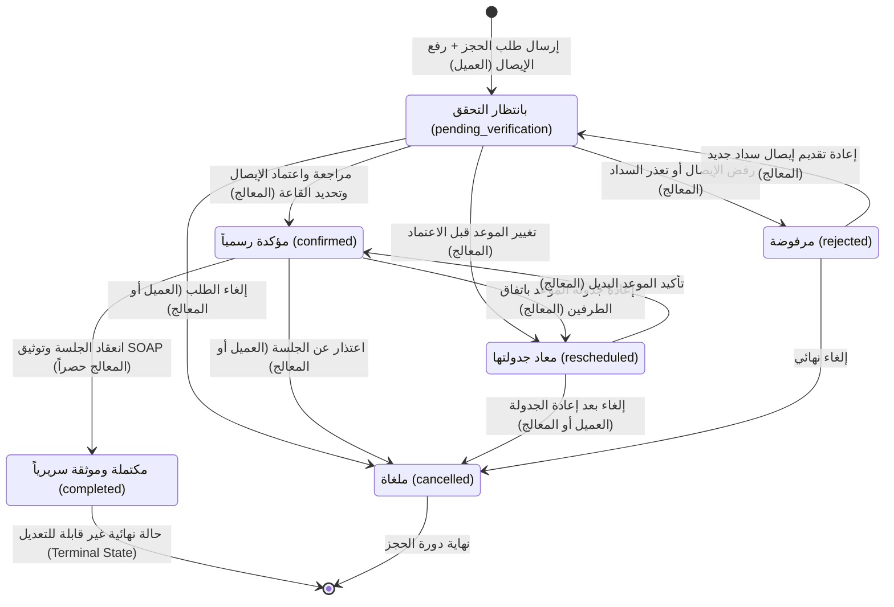

# المعمارية الأمنية وإدارة دورة حياة الحجوزات
## Security Architecture & Booking Lifecycle Specification

وثيقة مرجعية شاملة لمعمارية أمان المنصة، نموذج الصلاحيات الرباعي، دورة حياة الحجوزات السريرية، وقواعد عزل البيانات والتزامن.

---

### 1. دورة حياة الحجز وحالات الانتقال (Booking Lifecycle State Machine)

تخضع كافة الحجوزات في المنصة لآلة حالات صريحة ومقيدة أمنياً (Strict Finite State Machine)، تمنع أي تداخل أو قفزات غير مصرح بها بين الحالات:



#### قواعد الانتقال وصلاحيات الأدوار:
1. **العميل (Client)**: يقتصر حقه على إلغاء حجزه الخاص فقط (`cancelled`). لا يستطيع العميل اعتماد الحجز (`confirmed`)، ولا تعديل رابط الاجتماع (`meetLink`)، ولا تعديل الملاحظات السريرية (`notes`).
2. **المعالج (Counselor)**: يملك صلاحية مراجعة إيصال السداد، تحويل الحالة إلى `confirmed` وتعيين رابط قاعة اللقاء المباشر، إعادة الجدولة إلى موعد شاغر، وترقية الجلسة إلى `completed` بعد انعقادها وتوثيق سجل SOAP الإكلينيكي.
3. **الحالة النهائية المكتملة (Terminal State - completed)**: بعد اكتمال الجلسة، يُحظر تعديل حالتها أو التراجع عنها لضمان النزاهة السريرية والأثر المالي والقانوني.

---

### 2. الحدود الأمنية ونموذج الصلاحيات (Security Boundaries & 4-Tier RBAC)

تعتمد المنصة نموذج فصل المهام الصارم (Strict Separation of Duties) عبر 4 مستويات وصول:

```mermaid
graph TD
    subgraph "الزوار (Guest / Public)"
        G1[تصفح المقالات والمرئيات]
        G2[إجراء مقاييس التقييم الذاتي]
        G3[استعراض الكتالوج وحجز موعد أولي]
        G4[تسجيل الدخول / إنشاء حساب عميل]
    end

    subgraph "بوابة المستفيد (Client Portal - /profile)"
        C1[استعراض الجلسات المحجوزة ورابط Meet المؤكد]
        C2[تتبع التكليفات والتمارين الإرشادية وحلها]
        C3[مفكرة الخواطر والتواصل مع د. جلال]
        C4[سجل المزاج والسكينة اليومية]
        C5[إلغاء الحجز الخاص وتعديل الملف الشخصي]
    end

    subgraph "مساحة المعالج الإكلينيكية (/counselor - د. جلال أحمد)"
        D1[استوديو الجلسات المباشرة وتوثيق SOAP]
        D2[محرك الدليل التشخيصي DSM-5]
        D3[إدارة مواعيد وجدول التوفر الأسبوعي]
        D4[اعتماد الحجوزات ومراجعة إيصالات السداد]
        D5[الملفات الإكلينيكية الشاملة وتعيين التكليفات]
    end

    subgraph "لوحة إدارة المنصة العامة (/admin - Admin)"
        A1[إدارة المقالات والنشر الثقافي]
        A2[إدارة المرئيات والبودكاست]
        A3[إدارة كتالوج الكورسات والأكاديمية]
        A4[استقبال طلبات المؤسسات وصندوق النصيحة]
        A5[النشرة البريدية وإعدادات وسياسات المنصة]
    end

    G4 -->|جلسة عميل موثقة| C1
    G4 -->|جلسة المعالج د. جلال| D1
    G4 -->|جلسة مدير النظام| A1
```



#### حدود العزل:
- **صفر تداخل بين الإدارة والعيادة**: لا يطّلع مدير المنصة (`admin`) على السجلات السريرية أو ملاحظات SOAP أو تفاصيل المستفيدين النفسية، حيث تدار كافة شؤون الاستشارات حصراً عبر مساحة المعالج (`/counselor`).
- **صفر تسريب في واجهة العميل**: لا تظهر أي أزرار أو تبويبات أو روابط خاصة بمساحة المعالج أو الإدارة في بوابة المستفيد (`/profile`).

---

### 3. مصفوفة حماية مسارات الخادم (API Routes Security Matrix)

| المسار (API Endpoint) | الطريقة (Method) | المصادقة المطلوبة | الدور المسموح | تقييد الملكية (BOLA Guard) | معدل الطلبات (Rate Limit) | الوصف الأمني |
| :--- | :---: | :---: | :---: | :---: | :---: | :--- |
| `/api/auth/login` | POST | عام | الجميع | — | 5 طلبات / دقيقة | مصادقة بكلمة مرور مشفرة بـ PBKDF2، وتوليد كوكي `galal_session` آمن. |
| `/api/auth/register` | POST | عام | الجميع | دور `client` إجباري | 3 طلبات / دقيقة | إنشاء حساب عميل جديد مع تجزئة PBKDF2 برمل 16 بايت عشوائي. |
| `/api/auth/me` | GET | كوكي جلسة | الجميع | مستخدم الجلسة | 60 طلب / دقيقة | التحقق من توقيع الجلسة وإعادة بيانات المستخدم والدور. |
| `/api/auth/logout` | POST | كوكي جلسة | الجميع | — | 30 طلب / دقيقة | إبطال الجلسة ومسح الكوكي من المتصفح. |
| `/api/auth/forgot-password` | POST | عام | الجميع | بالهاتف/البريد | 3 طلبات / 15 دقيقة | طلب OTP مؤقت أو إعادة تعيين برمز صالح، منع الاستيلاء الفوري. |
| `/api/bookings` | GET | كوكي جلسة | الجميع | عميل: حجوزاته فقط | 60 طلب / دقيقة | جلب الحجوزات؛ يقتصر العميل على حجوزاته، والمعالج/الأدمن على الكل. |
| `/api/bookings` | POST | عام | الجميع | — | 5 طلبات / دقيقة | حجز موعد جديد، تدقيق Zod، منع الحجز المزدوج ذرّياً (409). |
| `/api/bookings` | PUT | كوكي جلسة | الجميع | عميل: إلغاء فقط | 20 طلب / دقيقة | تعديل الحجز؛ مقيد بآلة الحالات الصريحة وحماية الحالة المكتملة. |
| `/api/bookings/receipt` | GET | كوكي جلسة | الجميع | عميل: إيصاله فقط | 30 طلب / دقيقة | استرجاع إيصال السداد البنكي؛ مشفر ومحمي من وصول الغرباء. |
| `/api/clinical/soap` | POST | كوكي جلسة | counselor, admin | — | 20 طلب / دقيقة | حفظ وتوثيق سجلات SOAP السريرية في قاعدة البيانات. |
| `/api/clinical/homework` | GET | كوكي جلسة | الجميع | عميل: تكليفاته فقط | 40 طلب / دقيقة | قراءة التكليفات والواجبات الإرشادية. |
| `/api/clinical/homework` | POST | كوكي جلسة | counselor, admin | — | 20 طلب / دقيقة | إسناد تكليف سريري جديد لحالة معتمدة. |
| `/api/clinical/homework` | PUT | كوكي جلسة | الجميع | عميل: إجابته فقط | 20 طلب / دقيقة | تقديم إجابة التكليف من العميل أو تقييمها من المعالج. |
| `/api/user/profile` | GET | كوكي جلسة | الجميع | عميل: ملفه فقط | 40 طلب / دقيقة | قراءة الملفات؛ ترقيم الصفحات (Pagination) للأدمن/المعالج. |
| `/api/user/profile` | PUT | كوكي جلسة | الجميع | تعديل ملفه فقط | 20 طلب / دقيقة | تحديث الاسم أو الهاتف للمستخدم صاحب الجلسة فقط. |
| `/api/user/journal` | GET/POST | كوكي جلسة | الجميع | عميل: خواطره فقط | 30 طلب / دقيقة | حفظ واسترجاع يوميات وخواطر المستفيد والتواصل السري. |
| `/api/user/wellbeing` | GET/POST | كوكي جلسة | الجميع | عميل: سجله فقط | 30 طلب / دقيقة | تسجيل قراءات السكينة والمزاج اليومية. |
| `/api/availability` | GET | عام | الجميع | — | 60 طلب / دقيقة | عرض الأيام والأوقات المتاحة للحجز العام. |
| `/api/availability` | POST | كوكي جلسة | counselor, admin | — | 10 طلبات / دقيقة | تعديل جدول العمل وأوقات الحجز الأسبوعية. |
| `/api/admin/settings` | GET/POST | كوكي جلسة | admin | — | 20 طلب / دقيقة | إعدادات وسياسات الموقع العامة (مقتصرة على مدير النظام). |
| `/api/admin/courses` | GET/POST/PUT | كوكي جلسة | admin | — | 30 طلب / دقيقة | إدارة كتالوج الكورسات والمسارات التدريبية. |
| `/api/admin/send-email` | POST | كوكي جلسة | counselor, admin | — | 5 طلبات / دقيقة | إرسال بريد إلكتروني رسمي (محمي من استغلال Open Relay). |
| `/api/articles` | POST/DELETE | كوكي جلسة | admin | — | 15 طلب / دقيقة | نشر وتعديل وحذف المقالات في المنتدى الثقافي. |

---

### 4. معمارية منع الحجز المزدوج وحل التعارضات (Concurrency & Conflict Prevention)

لحماية المواعيد من التعارض المزدوج عند قيام مستفيدين بمحاولة حجز نفس الموعد في نفس اللحظة:
1. **الفحص الاستباقي (Pre-flight Conflict Check)**: يستعلم الخادم عن أي حجز نشط (غير ملغى وغير مرفوض) لنفس اليوم والوقت.
2. **القفل الذري في قاعدة البيانات (DB Atomic Constraint)**:
   ```sql
   CREATE UNIQUE INDEX IF NOT EXISTS idx_unique_active_booking_slot
   ON public.bookings (slot_date, slot_time)
   WHERE status NOT IN ('cancelled', 'rejected');
   ```
3. **التعامل مع سباق التزامن (Race Condition Handling)**: إذا وقع تضارب تزامني وتعارض في المفتاح الفريد، تعيد قاعدة البيانات رمز الخطأ `23505`، ويقوم مسار الخادم بترجمته فوراً إلى كود `409 Conflict` مع رسالة عربية واضحة:
   > «عذراً، هذا الموعد تم حجزه للتو من قِبل مستفيد آخر. يرجى اختيار موعد آخر متاح.»

---

### 5. خزانة إيصالات السداد وحمايتها (Receipt Vault Architecture)

لمنع تضخم قاعدة البيانات وحماية سرية التحويلات المالية:
1. **فحص البايتات السحرية (Magic Bytes Inspection)**: لا يعتمد الخادم على الامتداد الظاهري أو ترويسة المتصفح، بل يفحص التوقيع الثنائي الحقيقي للملف (JPEG: `FF D8 FF`, PNG: `89 50 4E 47`, WebP: `RIFF...WEBP`, PDF: `%PDF`).
2. **سقف الحجم (Size Boundary)**: الحد الأقصى المسموح 5 ميجابايت لمنع هجمات حرمان الخدمة (DoS).
3. **التخزين في حاوية سحابية خاصة أو خزانة محلية (Vault)**: يتم حفظ الملف في حاوية خاصة بترميز اسم عشوائي `BK-{id}-{timestamp}.ext`، وتخزين مرجع خفيف الوزن في قاعدة البيانات (`storage://...` أو `vault://...`).
4. **نقطة وصول محمية (`/api/bookings/receipt?id=...`)**: يُمنع استعراض الإيصال دون جلسة موثقة؛ يُسمح للمعالج والإدارة بالاطلاع، ويُسمح للعميل صاحب الحجز فقط برؤية إيصاله الخاص، مع منع أي عميل آخر من الوصول (403 Forbidden).

---

### 6. تشغيل حزم الاختبارات الآلية (Running Test Suites)

للتأكد من سلامة كافة الضوابط الأمنية ودورة حياة الحجز في أي وقت:

```bash
# 1. اختبارات الأمان والمصادقة وحدود الوصول (10 اختبارات)
node tests/security_tests.mjs

# 2. اختبارات دورة حياة الحجز والتزامن وإيصالات السداد (11 اختباراً)
node tests/booking_lifecycle_and_concurrency.mjs
```

---

### 7. إرشادات تدوير الأسرار والإنتاج (Production Secret Rotation Advisory)

> [!IMPORTANT]
> **إشعار هام لمالك المنصة:**
> 1. تم استبعاد وتطهير كافة كلمات المرور الثابتة والافتراضية من الكود المصدري نهائياً.
> 2. يُوصى فور النشر بتوليد وتدوير مفاتيح الإنتاج التالية في لوحة تحكم الاستضافة السحابية:
>    - `SESSION_SECRET`: مفتاح عشوائي مشفر لا يقل عن 32 بايت لتوقيع جلسات المستخدمين.
>    - `SUPABASE_SERVICE_ROLE_KEY`: تجديد المفتاح الإداري لقاعدة البيانات وتحديثه في متغيرات البيئة السرية فقط.
>    - `RESEND_API_KEY`: مفتاح إرسال البريد المعتمد لنطاق `galalahmad.com`.
>    - كلمة مرور حساب المعالج الإداري وحساب إدارة المنصة من خلال شاشة تسجيل الدخول الموحدة.
