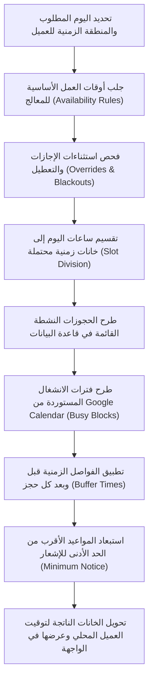

# وثيقة التصميم المعماري لتطوير منظومة الحجز الذكي (Advanced Booking System Design)
**تاريخ الوثيقة:** 14 نوفمبر 2026  
**المشروع:** منصة استشارات وبناء الإنسان - د. جلال أحمد (`galal-web`)  
**المسار:** `docs/design/booking.md`  
**الحالة:** مسودة تصميم معماري بانتظار الاعتماد (Design Document - Pending Review)  

---

## 1. الرؤية العامة والهدف الأساسي (Vision & Core Architecture)

الهدف هو **الحفاظ التام على المحرك الذري الحالي** المعتمد على القفل الاستشاري `pg_advisory_xact_lock` في قاعدة البيانات لمنع تداخل المواعيد، وتوسعته هندسياً بميزات متقدمة تضاهي كبرى المنصات العالمية (مثل Calendly و Cal.com)، ومخصصة للخصوصية الطبية والاستشارات الأسرية والنفسية.

---

## 2. الميزات المتقدمة وتصميمها المعماري (Advanced Features)

### أ. محرك المناطق الزمنية العالمي (Global Timezone Engine)
- **مبدأ التخزين الحصري بـ UTC:** تُحفظ كافة المواعيد في قاعدة البيانات بصيغة التوقيت العالمي الموحد `TIMESTAMPTZ` (UTC ISO 8601).
- **الاكتشاف والعرض بتوقيت العميل المحلي:**
  - يتم التعرف تلقائياً على المنطقة الزمنية لمتصفح المستفيد عبر `Intl.DateTimeFormat().resolvedOptions().timeZone` (مثل: `Europe/London`, `America/New_York`, `Asia/Riyadh`).
  - توفير قائمة منسدلة سهلة تتيح للمستفيد تبديل منطقته الزمنية يدوياً إذا رغب.
  - **عرض التوقيت المزدوج (Dual Clock Display):** إظهار توقيت العميل بوضوح مصحوباً بتوقيت العيادة الرسمي (بتوقيت القاهرة/مكة المكرمة) لمنع أي لبس.

### ب. المزامنة ثنائية الاتجاه مع Google Calendar (Two-Way Sync)
1. **تصدير المواعيد (Outbound Sync):**
   - فور اعتماد الحجز، يستدعي خادم Next.js واجهة Google Calendar API لإنشاء حدث رسمي في تقويم الدكتور جلال وتقويم المستفيد، يتضمن رابط Google Meet التلقائي وتذكير بالموعد.
2. **استيراد الانشغالات وحجب التعارضات (Inbound Busy Blocks):**
   - عندما يسجل الدكتور جلال موعداً شخصياً أو عائلياً في تقويم Google الخاص به، يقوم النظام بمسح فترات `freebusy` دورياً واستبعاد تلك الساعات تلقائياً من المواعيد المتاحة على الموقع، مما يمنع الحجز أثناء انشغال المعالج خارج المنصة.

### ج. الفترات الفاصلة بين الجلسات (Buffer Times)
- تتيح للمعالج وقتاً للراحة والتفريغ النفسي وكتابة الملاحظات السريرية (SOAP Notes) قبل استقبال العميل التالي.
- **الإعداد المعماري:**
  - فترة راحة قبل الجلسة: `buffer_before_minutes` (افتراضياً 5 دقائق).
  - فترة راحة بعد الجلسة: `buffer_after_minutes` (افتراضياً 15 دقيقة).
- **أثرها البرمجي:** إذا كانت الجلسة من 04:00 إلى 04:45 م مع فاصل 15 دقيقة، فإن أول موعد متاح تالٍ يبدأ عند 05:00 م.

### د. الحد الأدنى للإشعار المسبق (Minimum Notice Period)
- منع المستفيدين من حجز جلسات تبدأ خلال دقائق أو ساعات قليلة تفاجئ المعالج دون استعداد.
- **القاعدة البرمجية:** يُحظر حجز أي موعد يبدأ خلال أقل من **6 ساعات** (أو **12 ساعة** حسب إعداد المعالج) من التوقيت الفعلي للحجز.

### هـ. استثناءات الإجازات والأيام المخصصة (Vacations & Blackout Overrides)
- إمكانية تحديد تواريخ أو فترات استثنائية (إجازات الأعياد، إجازة سنوية، مؤتمرات علمية) تحجب جدول العمل الدوري بالكامل.
- إمكانية فتح ساعات عمل إضافية استثنائية في يوم عطلة محدد دون تغيير النمط الأسبوعي الدائم.

### و. روابط إعادة الجدولة والإلغاء الذاتي (Self-Service Tokens)
- في رسالة البريد الإلكتروني لتأكيد الحجز، يُرفق رابطان آمنان مشفران:
  - `https://www.galalahmad.com/booking/reschedule?token=[SignedSecureToken]`
  - `https://www.galalahmad.com/booking/cancel?token=[SignedSecureToken]`
- **الضوابط الأمنية:**
  - التوكن مشفر وموقّع خادمياً برمز HMAC، ويرتبط برقم الحجز ولا يكشف أي بيانات شخصية.
  - يسمح النظام بإعادة الجدولة أو الإلغاء الذاتي حتى **24 ساعة قبل موعد الجلسة**.
  - إذا تبقت أقل من 24 ساعة، يمنع النظام الإلغاء الذاتي ويوجه العميل لطلب استثناء مباشر من العيادة وفق سياسة الإلغاء.

### ز. ملفات التقويم القياسية (Standard ICS Calendar File)
- توليد كائن `text/calendar` متوافق مع معيار RFC 5545 يرفق مع كل بريد تأكيد أو تعديل موعد، يتيح للعميل بضغطة زر إضافة الموعد لتقويم Apple Calendar أو Outlook بنقرة واحدة.

### ح. قائمة الانتظار الذكية (Waitlist Engine)
- في حال كانت مواعيد أسبوع معين محجوزة بالكامل بنسبة 100%، يظهر للمستفيد زر: `الانضمام لقائمة الانتظار لهذا الأسبوع`.
- يُسجل المستفيد اسمه وهاتفه وإيميله والمسار المطلوب.
- **التشغيل الآلي:** إذا ألغى أي عميل موعده أو أعاد جدولته، يفحص النظام أول طلب في قائمة الانتظار ويرسل له إشعاراً فورياً عبر البريد والواتساب مع رابط حجز مخصص صالح لمدة **ساعتين** فقط قبل تحويل الفرصة للشخص التالي.

### ط. باقات الجلسات المخفضة (Session Packages & Bundles)
- تمكين المستفيدين من شراء باقة علاجية (مثل: «باقة المتابعة النفسية - 4 جلسات» أو «باقة الإرشاد الزواجي المكثف - 6 جلسات») بسعر تفضيلي.
- يُضاف رصيد الجلسات لحساب المستفيد في جدول `user_package_balances`.
- عند الدخول لصفحة الحجز، يختار المستفيد: `الدفع من رصيد الباقة النشطة (متبقي 3 جلسات)`، ويتم تثبيت الموعد فوراً بدون دفع بنكي جديد وبشكل آلي 100%.

### ي. الجلسات الزوجية بطرفين (Dual-Participant Couple Sessions)
- تتطلب الاستشارات الزوجية حضور الزوج والزوجة في نفس الجلسة الافتراضية.
- **التصميم:**
  - يتضمن نموذج حجز المسار الزواجي حقولاً لكلا الطرفين: (اسم الزوج، هاتفه، بريده) و (اسم الزوجة، هاتفها، بريدها).
  - يُرسل رابط Google Meet وتذكيرات الموعد بشكل متزامن ومنفصل لكل منهما.
  - يُربط كلا الطرفين بنفس ملف الاستشارة العائلية المشترك في لوحة المعالج.

### ك. استبيان وموافقة ما قبل الجلسة الأولى (Pre-Session Clinical Intake)
- قبل انعقاد الجلسة الأولى، يتلقى العميل إشعاراً لإكمال استبيان التاريخ الاستشاري:
  1. الهدف الرئيسي من طلب الاستشارة وأهم الصعوبات الحالية.
  2. هل توجد محاولات أو أفكار إيذاء للنفس أو الغير؟ (فحص الخطورة والفرز السريري Triage).
  3. اسم ورقم جهة اتصال لحالات الطوارئ (Emergency Contact).
  4. التوقيع الرقمي على ميثاق الخصوصية والسرية وحدودها الأخلاقية.

---

## 3. دراسة خوارزمية التوفر (Availability Algorithm - مرجع Cal.diy / MIT)

تمت دراسة خوارزمية حساب وتوليد الفترات الزمنية المتاحة (Slot Generation) المتبعة في المشاريع المعتمدة على رخصة **MIT** (مثل Cal.diy):



> **الالتزام الصارم بالتراخيص:** لن يتم نسخ أي كود خاضع لرخصة AGPL نهائياً. تعتمد الخوارزمية كوداً أصيلاً بنسبة 100% مبنياً بلغة TypeScript على محرك Next.js وقواعد بيانات Supabase.

---

## 4. مسودات ترحيلات قاعدة البيانات (Draft SQL Migrations)

> [!NOTE]
> هذه مسودات تصميمية استرشادية **دون تنفيذ فعلي** على قاعدة البيانات في هذه المرحلة:

```sql
-- ==============================================================================
-- DRAFT MIGRATION: Advanced Booking Architecture & Availability Engine
-- ==============================================================================

BEGIN;

-- 1. جدول قواعد ساعات العمل الأسبوعية الدورية للمعالج
CREATE TABLE IF NOT EXISTS public.counselor_availability_rules (
    id UUID PRIMARY KEY DEFAULT gen_random_uuid(),
    day_of_week INT NOT NULL CHECK (day_of_week BETWEEN 0 AND 6), -- 0=الأحد, 6=السبت
    start_time TIME NOT NULL,
    end_time TIME NOT NULL,
    buffer_before_minutes INT DEFAULT 5,
    buffer_after_minutes INT DEFAULT 15,
    min_notice_hours INT DEFAULT 6,
    is_active BOOLEAN DEFAULT TRUE,
    created_at TIMESTAMPTZ DEFAULT NOW()
);

-- 2. جدول استثناءات الإجازات والأيام المخصصة (Overrides & Holidays)
CREATE TABLE IF NOT EXISTS public.counselor_schedule_overrides (
    id UUID PRIMARY KEY DEFAULT gen_random_uuid(),
    override_date DATE NOT NULL,
    is_blackout_day BOOLEAN DEFAULT TRUE, -- يوم إجازة كامل
    custom_start_time TIME NULL,
    custom_end_time TIME NULL,
    reason TEXT NULL, -- سبب الإجازة (مؤتمر، عطلة رسمية)
    created_at TIMESTAMPTZ DEFAULT NOW()
);

-- 3. جدول باقات الجلسات ورصيد المشتركين
CREATE TABLE IF NOT EXISTS public.session_packages (
    id UUID PRIMARY KEY DEFAULT gen_random_uuid(),
    title TEXT NOT NULL,
    track TEXT NOT NULL,
    session_count INT NOT NULL CHECK (session_count > 1),
    total_price NUMERIC(10,2) NOT NULL,
    validity_days INT DEFAULT 90, -- صلاحية الباقة 3 أشهر
    is_active BOOLEAN DEFAULT TRUE,
    created_at TIMESTAMPTZ DEFAULT NOW()
);

CREATE TABLE IF NOT EXISTS public.user_package_balances (
    id UUID PRIMARY KEY DEFAULT gen_random_uuid(),
    user_id UUID NOT NULL REFERENCES public.profiles(id) ON DELETE CASCADE,
    package_id UUID NOT NULL REFERENCES public.session_packages(id),
    total_credits INT NOT NULL,
    remaining_credits INT NOT NULL,
    expires_at TIMESTAMPTZ NOT NULL,
    status TEXT DEFAULT 'active', -- active, exhausted, expired
    created_at TIMESTAMPTZ DEFAULT NOW()
);

-- 4. جدول قائمة الانتظار للمواعيد المكتملة
CREATE TABLE IF NOT EXISTS public.booking_waitlist (
    id UUID PRIMARY KEY DEFAULT gen_random_uuid(),
    user_id UUID REFERENCES public.profiles(id) ON DELETE CASCADE,
    client_name TEXT NOT NULL,
    client_phone TEXT NOT NULL,
    client_email TEXT NOT NULL,
    preferred_track TEXT NOT NULL,
    preferred_date DATE NOT NULL,
    status TEXT DEFAULT 'waiting', -- waiting, notified, booked, expired
    notified_at TIMESTAMPTZ NULL,
    expires_at TIMESTAMPTZ NULL,
    created_at TIMESTAMPTZ DEFAULT NOW()
);

-- 5. جدول أطراف الجلسات الزوجية (Couple Booking Participants)
CREATE TABLE IF NOT EXISTS public.couple_booking_participants (
    id UUID PRIMARY KEY DEFAULT gen_random_uuid(),
    booking_id TEXT NOT NULL REFERENCES public.bookings(id) ON DELETE CASCADE,
    partner_a_name TEXT NOT NULL,
    partner_a_phone TEXT NOT NULL,
    partner_a_email TEXT NOT NULL,
    partner_b_name TEXT NOT NULL,
    partner_b_phone TEXT NOT NULL,
    partner_b_email TEXT NOT NULL,
    created_at TIMESTAMPTZ DEFAULT NOW()
);

-- 6. جدول استبيان التقييم والموافقة المستنيرة قبل الجلسة الأولى
CREATE TABLE IF NOT EXISTS public.pre_session_intakes (
    id UUID PRIMARY KEY DEFAULT gen_random_uuid(),
    booking_id TEXT NOT NULL REFERENCES public.bookings(id) ON DELETE CASCADE,
    user_id UUID NOT NULL REFERENCES public.profiles(id),
    primary_concerns TEXT NOT NULL,
    symptoms_duration TEXT NOT NULL,
    has_self_harm_thoughts BOOLEAN NOT NULL DEFAULT FALSE,
    emergency_contact_name TEXT NOT NULL,
    emergency_contact_phone TEXT NOT NULL,
    consent_signed_at TIMESTAMPTZ NOT NULL,
    created_at TIMESTAMPTZ DEFAULT NOW()
);

COMMIT;
```

---

## 5. ملخص القرارات والبدائل والمخاطر والجهد

- **القرارات المقترحة:**
  1. اعتماد التخزين الدولي بصيغة UTC لجميع المواعيد وتفعيل العرض المزدوج لمنع ارتباك الجاليات المغتربة.
  2. تفعيل المزامنة ثنائية الاتجاه مع Google Calendar لحجب أوقات انشغال المعالج آلياً.
  3. اعتماد حد أدنى للإشعار (6 ساعات) وفاصل 15 دقيقة بعد كل جلسة لكتابة SOAP وتجديد الطاقة الذهنية.
- **البدائل:** استخدام أداة خارجية مغلقة مثل Calendly وتضمينها عبر iframe؛ وتم استبعاد ذلك لعدم إمكانية عزل البيانات الطبية، وعدم دعم إنستاباي/التحويلات العربية، وارتفاع التكلفة الشهرية.
- **المخاطر:** تضارب تحديثات Google Calendar في حال انقطاع اتصال الإنترنت؛ ويتم تفاديه بالاعتماد على Webhook مع فحص دوري مجدول كل 15 دقيقة.
- **تقدير الجهد:** **7 إلى 9 أيام عمل** (10 نقاط برمجية Story Points).
- **أسئلة تنتظر قرار الدكتور جلال:**
  1. كم تفضل أن تكون الفترة الفاصلة بين الجلسات (10 دقائق أم 15 دقيقة)؟
  2. ما هو الحد الأدنى المقترح للإشعار المسبق قبل الحجز (6 ساعات أم 12 ساعة)؟
  3. هل ترغب في إتاحة باقات الجلسات المخفضة (مثل باقة 4 جلسات) عند تدشين النظام المحدث؟
