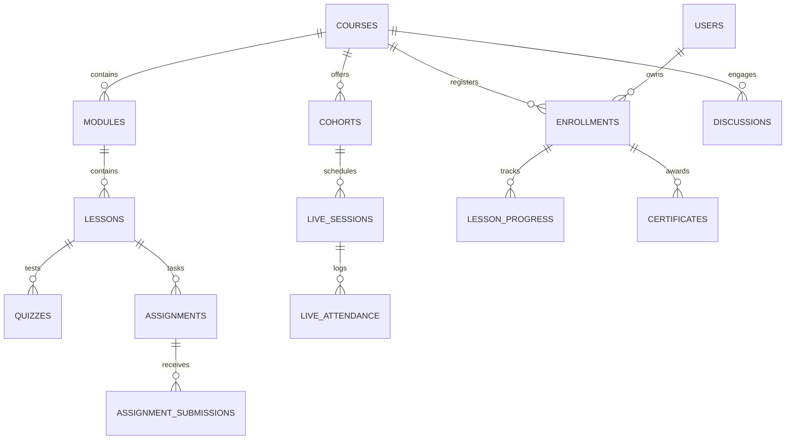

# وثيقة التصميم المعماري لوحدة الدورات والأكاديمية (Courses & Academy Design Document)
**تاريخ الوثيقة:** 14 نوفمبر 2026  
**المشروع:** منصة استشارات وبناء الإنسان - د. جلال أحمد (`galal-web`)  
**المسار:** `docs/design/courses.md`  
**الحالة:** مسودة تصميم معماري بانتظار الاعتماد (Design Document - Pending Review)  

---

## 1. الرؤية العامة والأهداف (Overview & Objectives)

تهدف وحدة الدورات إلى توفير بيئة تعليمية وأكاديمية متكاملة تحت العلامة الرسمية للدكتور جلال أحمد، تدعم نمطين أساسيين من التعليم:
1. **الدورات الذاتية المسجلة (Self-Paced On-Demand Courses):** محتوى فيديو عالي الجودة مقسم إلى وحدات ودروس، يشاهده المستفيد حسب وقته، مع اختبارات فهم وتكليفات ذاتية.
2. **البرامج التفاعلية القائمة على الدفعات (Cohort-Based Live Programs):** مثل «برنامج ميثاق لبناء الزواج» و«دبلوم التربية الوالدية المتزنة»، وتتضمن جدولاً زمنياً محدداً، جلسات بث مباشر أسبوعية، نقاشات جماعية، ومتابعة حضور وغياب دورية.

---

## 2. نموذج البيانات والكيانات والعلاقات (Data Model & Schema)

تم تصميم نموذج البيانات ليعمل داخل قاعدة بيانات PostgreSQL عبر **Supabase**، مع مراعاة العزل التام والفهارس الذكية لتحقيق أعلى أداء:

### تفصيل الجداول والحقول الأساسية:

1. **`courses` (جدول الدورات):**
   - `id`: UUID (Primary Key)
   - `title`: TEXT (اسم الدورة بالعربية)
   - `slug`: TEXT UNIQUE (الرابط الدائم للمسار التعليمي)
   - `description`: TEXT (الوصف والمنهج التعليمي)
   - `category`: TEXT (أسرة، تربية، يافعين، بناء ذات)
   - `cover_image`: TEXT (رابط صورة الغلاف)
   - `price`: NUMERIC(10, 2) (السعر)
   - `currency`: VARCHAR(3) (SAR, EGP, USD)
   - `is_cohort_based`: BOOLEAN (هل هي بنظام الدفعات أم مسجلة دائمة)
   - `instructor_id`: UUID (المدرب المسؤول - ForeignKey لـ `profiles`)
   - `is_published`: BOOLEAN DEFAULT FALSE
   - `created_at`, `updated_at`: TIMESTAMPTZ

2. **`cohorts` (جدول الدفعات والمجموعات):**
   - `id`: UUID (Primary Key)
   - `course_id`: UUID (مربوط بـ `courses`)
   - `name`: TEXT (مثل: دفعة نوفمبر 2026 - المجموعة الأولى)
   - `start_date`: DATE (تاريخ بدء الدفعة)
   - `end_date`: DATE (تاريخ التخرج)
   - `capacity`: INT (الحد الأقصى للمقاعد، مثلاً 30 متدرباً)
   - `status`: TEXT (upcoming, open, in_progress, completed)

3. **`modules` و `lessons` (الوحدات والدروس):**
   - `modules`: `id`, `course_id`, `title`, `sort_order`
   - `lessons`: `id`, `module_id`, `title`, `sort_order`, `lesson_type` (video, text, live, quiz, assignment), `duration_minutes`, `video_provider` (bunny, cloudflare), `video_id`, `content_markdown`, `is_preview_free`

4. **`enrollments` (التسجيل والاشتراكات):**
   - `id`: UUID (Primary Key)
   - `user_id`: UUID (المستفيد - ForeignKey لـ `profiles`)
   - `course_id`: UUID (مربوط بـ `courses`)
   - `cohort_id`: UUID NULLABLE (إذا كان التسجيل ضمن دفعة معينة)
   - `status`: TEXT (pending_payment, active, completed, cancelled)
   - `payment_method`: TEXT (instapay, bank_transfer, electronic)
   - `receipt_image`: TEXT (مرجع الإيصال البنكي المشفر)
   - `enrolled_at`: TIMESTAMPTZ
   - `approved_by`: UUID (المعالج أو الأدمن الذي اعتمد التحويل)

5. **`lesson_progress` (تتبع التقدم وإكمال الدروس):**
   - `id`: UUID (Primary Key)
   - `enrollment_id`: UUID
   - `lesson_id`: UUID
   - `is_completed`: BOOLEAN DEFAULT FALSE
   - `last_watched_second`: INT DEFAULT 0
   - `completed_at`: TIMESTAMPTZ NULLABLE

6. **`quizzes` و `assignments` (الاختبارات والواجبات التطبيقية):**
   - `quizzes`: أسئلة تقييم الفهم مع علامة اجتياز (Passing Score %)، وتصحيح آلي فوري.
   - `assignments`: تكليفات سلوكية وأسرية يقدمها المتدرب، وتصحح يدوياً من المدرب مع تقديم تغذية راجعة سرية (Feedback).

7. **`live_sessions` و `live_attendance` (الجلسات المباشرة ورصد الحضور):**
   - `live_sessions`: `id`, `cohort_id`, `title`, `scheduled_at`, `duration_minutes`, `meeting_url`, `recording_url`
   - `live_attendance`: `id`, `live_session_id`, `user_id`, `joined_at`, `left_at`, `attended_minutes`, `attended` (boolean)

8. **`certificates` (الشهادات الرقمية):**
   - `id`: UUID (Primary Key)
   - `enrollment_id`: UUID
   - `certificate_code`: TEXT UNIQUE (كود فريد للتحقق، مثل: `GA-MITHAQ-2026-084`)
   - `recipient_name`: TEXT
   - `course_title`: TEXT
   - `issue_date`: DATE
   - `qr_verification_url`: TEXT (`https://www.galalahmad.com/verify/[code]`)
   - `pdf_storage_ref`: TEXT (مرجع ملف PDF المولد)

---

## 3. تكامل الصلاحيات ودور المدرب الجديد (`instructor` RBAC)

تعتمد المنصة حالياً نظام صلاحيات ثلاثي (`client`, `counselor`, `admin`). لإضافة دور المدرب الأكاديمي (`instructor`)، يتم دمجه في معمارية [src/lib/serverAuth.ts](file:///c:/Projects/galal-web/src/lib/serverAuth.ts) مع ضمان **العزل الطبي التام**:

| الصلاحية / المورد | طالب / مستفيد (`client`) | مدرب الأكاديمية (`instructor`) | مدير المنصة (`admin`) | المستشار د. جلال (`counselor`) |
| :--- | :---: | :---: | :---: | :---: |
| **استعراض الدروس والمحتوى** | للدورات المشترك بها فقط | لكافة دوراته المسندة إليه | كامل المنصة | كامل المنصة |
| **إنشاء وتعديل محتوى الدورات** | ❌ محظور | لدوراته فقط | كامل المنصة | كامل المنصة |
| **تصحيح واجبات الطلاب** | ❌ محظور | لطلابه فقط | متاح إدارياً | متاح بالكامل |
| **جدولة الجلسات المباشرة** | ❌ محظور | لدفعاته فقط | متاح إدارياً | متاح بالكامل |
| **اعتماد إيصالات سداد الدورات**| ❌ محظور | ❌ محظور (مالي) | متاح إدارياً | متاح بالكامل |
| **الاطلاع على الاستشارات والـ SOAP**| ❌ محجوب | 🛑 **محظور قطيعاً (403)** | 🛑 **محظور قطيعاً (403)** | مصرح حصرياً للمعالج |
| **الاطلاع على خواطر المستفيدين**| ليومياته فقط | 🛑 **محظور قطيعاً (403)** | 🛑 **محظور قطيعاً (403)** | بموافقة العميل فقط |

---

## 4. مقارنة مزودي استضافة وبث الفيديو المسجل (VOD Video Hosting)

| المعيار الفني والتجاري | **Bunny Stream** (الخيار الموصى به) | **Cloudflare Stream** | **Mux Video** |
| :--- | :--- | :--- | :--- |
| **التكلفة التقديرية (100 ساعة فيديو)** | **رخيصة جداً:** ~$1 تخزين + ~$2.5 استهلاك شهري `[يحتاج تحقق - Needs Verification: حاسبة أسعار Bunny.net الرسمية حسب استهلاك الباندويث في الشرق الأوسط]` | معتدلة: ~$5 تخزين + ~$10 استهلاك `[يحتاج تحقق: وثائق تسعير Cloudflare Stream الرسمية]` | باهظة: ~$10 تخزين + ~$42 استهلاك `[يحتاج تحقق: وثائق تسعير Mux Video]` |
| **حماية الروابط وتشفير HLS** | مدعوم بقوة عبر Token Authentication و HLS AES-128 | مدعوم عبر Signed URLs (RSA / Ed25519) | مدعوم عبر Playback Restrictions JWT |
| **العلامة المائية الديناميكية (Watermark)** | **مدمجة:** إظهار اسم المشترك ورقم هاتفه عشوائياً فوق الفيديو لمنع تصوير الشاشة `[يحتاج تحقق - Needs Verification: التحقق من إتاحة الميزة في مشغل Bunny المدمج أو كود المشغل في الواجهة]` | تتطلب مشغل مخصص وتطويراً برمجياً من جانب العميل | تتطلب مشغل مخصص وتطويراً إضافياً |
| **سرعة وأداء CDN في المنطقة العربية** | ممتازة (خوادم في الرياض، دبي، إسطنبول، فرانكفورت) | استثنائية (أكبر شبكة CDN عالمية) | جيدة جداً (تعتمد على شبكات Fastly/Cloudflare) |
| **سهولة المشغل والتكامل مع React** | مكتبة متكاملة وسهلة أو مشغل iframe آمن | مشغل Cloudflare Web Component جاهز | مشغل Mux Player React متطور جداً |

> **التوصية الفنية:** **Bunny Stream** يمثل الخيار الأمثل والأنسب مالياً وأمنياً لمنصة الدكتور جلال، لامتلاكه ميزة العلامة المائية الديناميكية المباشرة وتكلفته التي تقل بنسبة تصل إلى 80% عن المنافسين `[يحتاج تحقق - Needs Verification: مبني على مقارنة حجم نقل البيانات 1TB شهرياً]` مع جودة بث فائقة في الشرق الأوسط.

---

## 5. مقارنة منظومة البث المباشر (Live Sessions Streaming)

| المعيار | **روابط Google Meet المؤتمتة** (البداية الموصى بها) | **LiveKit Cloud / Self-Hosted** (المرحلة المتقدمة) | **Jitsi Meet** |
| :--- | :--- | :--- | :--- |
| **طبيعة الاندماج بالمنصة** | نافذة خارجية أو رابط رسمي يفتحه المتدرب | **مدمج 100% داخل الموقع** دون مغادرة المنصة | مدمج عبر iframe خارجي |
| **التكلفة** | مجاني ضمن حساب Google Workspace | مجاني حتى 10,000 دقيقة/شهر، ثم $0.004/دقيقة | مجاني مفتوح المصدر (لكن خوادمه مكلفة) |
| **رصد الحضور والغياب برمجياً** | يدوي أو عبر تفريغ سجل Google Meet | **آلي ولحظي بدقة الثانية** عبر Webhooks | يحتاج إعداد إضافي معقد للـ API |
| **الاستقرار والصيانة** | استقرار تام تضمنه شركة Google دون صيانة | بنية تحتية سحابية جاهزة للمطورين | يتطلب صيانة شاقة لخوادم WebRTC SFU |
| **التسجيل السحابي للجلسة** | تسجيل مباشر في Google Drive | تسجيل آلي (Egress) وحفظه في S3 | يتطلب خادم Jibri إضافي معقد |

> **التوصية الفنية للبث:** البدء بروابط **Google Meet** المؤتمتة عبر Google Calendar API للدفعات الأولى لضمان الصفر أخطاء وألفة المستخدمين الكاملة بها، مع تصميم بنية الجداول لدعم الانتقال إلى **LiveKit** عندما يتجاوز عدد المشتركين في الدفعة 50 طالباً.

---

## 6. إجراءات التسجيل والشهادات وموافقة القُصّر

### أ. التسجيل بالدفع اليدوي واعتماد الإدارة
1. يختار المستفيد الدورة أو الدفعة -> يظهر له الحساب البنكي / إنستاباي.
2. يرفع المستفيد صورة إيصال السداد مع كتابة اسم المحوّل ورقم الحساب.
3. يُسجل الاشتراك بحالة `pending_payment` ويُحجز المقعد لمدة 24 ساعة.
4. يظهر إشعار فوري في لوحة المعالج/الأدمن مع صورة الإيصال الموقّعة.
5. عند نقر `اعتماد الاشتراك ✓`، يتحول الاشتراك إلى `active` ويُرسل بريد ترحيبي برابط الانضمام للدفعة وقناة التواصل المباشرة.

### ب. شهادات الإتمام الرقمية باللغة العربية (PDF Generation)
- **شروط الاستحقاق الآلية:** إكمال 100% من الدروس الأساسية + اجتياز الاختبارات بنسبة لا تقل عن 75% + حضور 80% من الجلسات المباشرة.
- **التنفيذ التقني:** توليد الشهادة خادمياً باستخدام `@react-pdf/renderer` مدمجاً به خط عربي أصيل من عائلة الخطوط المعتمدة (مثل Cairo أو Amiri)، مع خلفية مزخرفة رسمية وتوقيع معتمد للدكتور جلال.
- **التحقق من صحة الشهادة:** تتضمن الشهادة رمز استجابة سريعة **QR Code** يقود إلى رابط عام: `https://www.galalahmad.com/verify/[certificateCode]` يُظهر اسم المتدرب وتاريخ التخرج ورقم الاعتماد لمنع التزوير.

### ج. موافقة ولي الأمر في دورات المراهقين واليافعين
- في الدورات الموجهة لليافعين (أقل من 18 عاماً):
  1. يُلزم النموذج بإدخال اسم ولي الأمر، صلته بالمتدرب، ورقم هاتفه.
  2. يُرسل رمز OTP لرقم ولي الأمر لتأكيد اطلاعه وموافقته على انضمام ابنه/ابنته للبرنامج.
  3. يتم توثيق الموافقة في سجل التسجيل كإقرار قانوني وأخلاقي ملزم.

---

## 7. مقارنة استراتيجية للخيارات الثلاثة لبناء الأكاديمية

| المعيار والمحدد | **(أ) بناء وحدة خفيفة مدمجة (Native LMS)** | **(ب) Frappe LMS على نطاق فرعي** | **(ج) Moodle على نطاق فرعي** |
| :--- | :--- | :--- | :--- |
| **الترخيص وأثره القانوني** | **ملك كامل للمنصة (Proprietary / MIT)** دون أي قيود ترخيصية | **AGPL-3.0:** يُلزم قانونياً بنشر وتوزيع أي تعديل على كود المنصة كشفرة مفتوحة | **GPL-3.0:** يتطلب عزل النطاق تماماً وله قيود مشددة على التعديلات التجارية |
| **تجربة المستخدم والهوية البصرية** | **متطابقة 100%:** نفس التصميم، نفس الخطوط، ونفس الألوان، دون شعور بالانتقال لموقع آخر | جيدة لكنها تتبع تصميم منصة Frappe مع صعوبة تطابق التفاصيل الدقيقة | **ضعيفة وعقيمة:** واجهات مودل الأكاديمية التقليدية معقدة وثقيلة ومنفرة للمستخدم العربي |
| **دعم اللغة العربية والـ RTL** | **أصيل ومثالي 100%** (لأن المنصة مبنية عربية بالكامل من الأساس) | **غير مكتمل:** يحتاج تعريباً يدوياً واسعاً وملفات ترجمة مخصصة وعلاج لكسور الـ RTL | **مدعوم رسمياً:** لكنه تقليدي ومكتظ بالنصوص والمصطلحات الأكاديمية الجامدة |
| **إدارة المستخدمين وتسجيل الدخول** | **حساب موحد وجلسة واحدة:** المستفيد يتنقل بين استشارته ودورته بنفس الحساب والكوكيز | يتطلب ربط OAuth / SSO عبر بروتوكولات OIDC ومزامنة دورية لقواعد البيانات | يتطلب ربط SSO معقد وإدارة منفصلة لمستخدمي المنصتين |
| **جهد التطوير الأولي** | متوسط (حوالي 8 إلى 10 أيام عمل للمرحلة الأولى) | متوسط (3-5 أيام لإعداد الخادم وربط النطاق والـ SSO) | كبير وصعب في تخصيص القوالب وتطهير الثيمات |
| **تكاليف التشغيل والصيانة** | **صفر خوادم إضافية:** تعمل على نفس خادم Next.js وقاعدة Supabase الحالية | خادم Linux VPS مخصص (2-4GB RAM) وصيانة لتحديثات نظام Frappe و Bench | خادم Linux VPS مخصص وصيانة دورية لترقيات PHP / MySQL / Moodle |

### التوصية النهائية والمبررات:
نوصي بشكل قاطع بـ **الخيار (أ): بناء وحدة خفيفة مدمجة (Native LMS)** داخل المشروع الحالي؛ للأسباب التالية:
1. **حماية الملكية وتجنب فخ تراخيص AGPL:** استخدام Frappe LMS المرخص بـ AGPL-3.0 قد يعرض المنصة لإشكاليات قانونية تلزم بفتح مصادر الكود عند دمجها، في حين أن البناء المدمج يحفظ الملكية الخاصة لمنصة الدكتور جلال بنسبة 100%.
2. **تجربة مستخدم عربية انسيابية (Single Sign-On & Unified UX):** يتيح للمستفيد متابعة واجباته واستشاراته ودوراته من ملف شخصي واحد وبنفس الهوية البصرية الهادئة.
3. **انعدام تكاليف الاستضافة الإضافية:** لا يتطلب استئجار وإدارة خوادم VPS إضافية ومحركات قواعد بيانات منفصلة.

---

## 8. ملخص القرارات والبدائل والمخاطر والجهد

- **القرارات المقترحة:**
  1. اعتماد الخيار (أ) ببناء وحدة LMS مدمجة وخفيفة في Next.js و Supabase.
  2. اعتماد مزود **Bunny Stream** للفيديو المسجل مع التوقيع المشفر والعلامة المائية الديناميكية.
  3. اعتماد **روابط Google Meet المؤتمتة** كحل فوري للبث المباشر، مع التجهيز المعماري لـ LiveKit مستقبلاً.
- **البدائل:** استخدام منصة استضافة تعليمية خارجية مغلقة (مثل Teachable أو Kajabi)، لكنها مكلفة ($150+/شهر)، وتفتقد للهوية العربية وعزل البيانات.
- **المخاطر:** تسريب محتوى الدورات بتصوير الشاشة؛ ويتم تحييده بتفعيل العلامة المائية الديناميكية لاسم المشترك ورقم هاتفه فوق الفيديو.
- **تقدير الجهد:** **10 إلى 12 يوم عمل** (13 نقطة برمجية Story Points).
- **أسئلة تنتظر قرار الدكتور جلال:**
  1. هل ترغب في إتاحة شهادات إتمام لكافة الدورات أم تقتصر فقط على برامج الدفعات الكبرى (مثل ميثاق)؟
  2. ما هو السن الأدنى المعتمد لديكم لطلب موافقة ولي الأمر الإلزامية (16 سنة أم 18 سنة)؟
