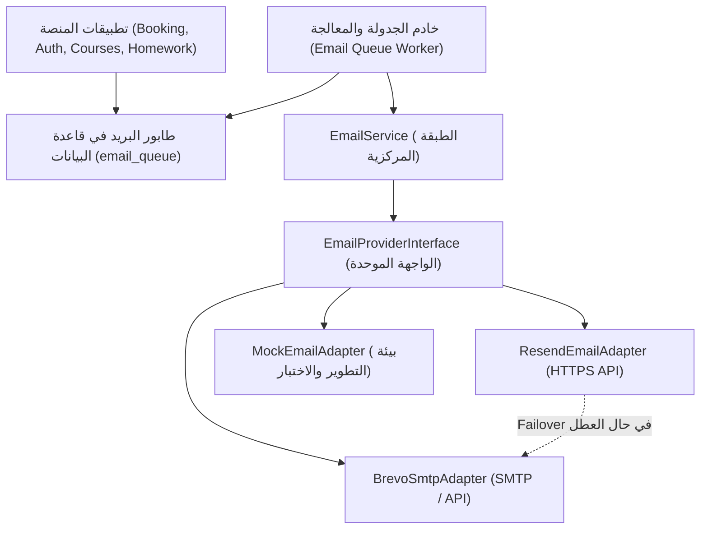
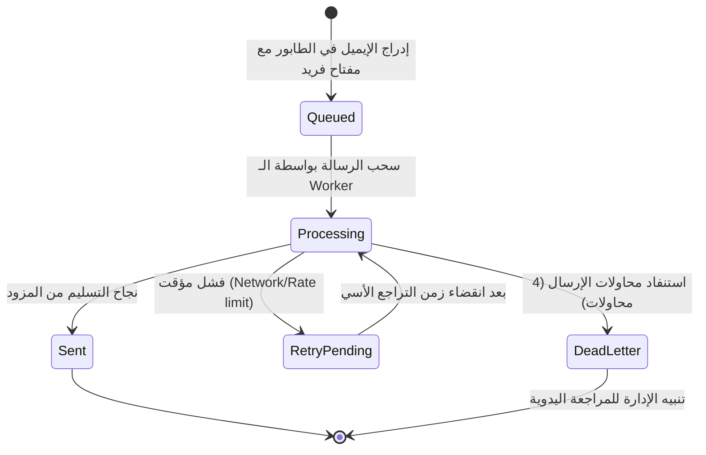
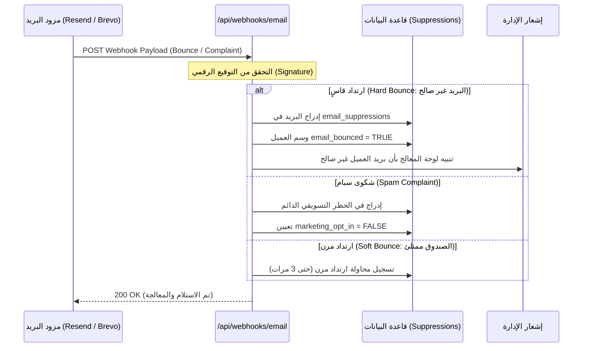

# وثيقة التصميم المعماري لمنظومة البريد الإلكتروني والإشعارات (Transactional Email System & Notification Engine)
**تاريخ الوثيقة:** 14 نوفمبر 2026  
**المشروع:** منصة استشارات وبناء الإنسان - د. جلال أحمد (`galal-web`)  
**المسار:** `docs/design/email.md`  
**الحالة:** مسودة تصميم معماري بانتظار الاعتماد (Design Document - Pending Review)  

---

## 1. الرؤية العامة والقاعدة السريرية الحاسمة (Vision & Strict Clinical Privacy Mandate)

تُمثل منظومة البريد الإلكتروني في منصة د. جلال أحمد شريان التواصل الرسمي والموثوق مع المستفيدين والطلاب والمؤسسات. ولأن المنصة تقدم استشارات نفسية وزوجية وأسرية، فإن الاعتبارات الأمنية والخصوصية الطبية تتجاوز مجرد التسليم التقني للرسائل إلى الحماية القانونية والأخلاقية للمستفيد.

### 🛡️ القاعدة الذهبية للسرية السريرية (Zero Clinical Details in Emails Rule)
> [!CAUTION]
> **ممنوع قطعيًا تضمين أي تفاصيل سريرية أو طبية أو تشخيصية داخل عنوان أو متن أي بريد إلكتروني!**
> 
> - **المحذورات المطلقة:**
>   - لا يُذكر إطلاقًا اسم أي اضطراب أو تشخيص أو تصنيف نفسي (مثل: اكتئاب، قلق، وسواس، صدمة، اضطراب الهلع، إلخ).
>   - لا تُذكر أسئلة أو إجابات استبيان التقييم السريري (DSM-5 Intake).
>   - لا يُذكر نص الملاحظات الطبية أو السريرية أو ملخص جلسات المعالج (SOAP Notes).
>   - لا يُذكر نص أو مضمون التكليفات والواجبات السلوكية (CBT Exercises)؛ بل يُكتفى بإشعار إداري عام.
> - **الصياغة الإدارية المحايدة المعتمدة:**
>   - عنوان الرسالة: `تأكيد موعد جلستك الاستشارية | د. جلال أحمد` أو `إشعار إداري بشأن حسابك | د. جلال أحمد`.
>   - نص التنبيه: *"تمت إضافة تكليف إرشادي جديد إلى ملفك الشخصي الآمن على المنصة، يُرجى تسجيل الدخول للاطلاع عليه."*
> - **السبب المهني والقانوني:**
>   - البريد الإلكتروني وسيط نقل غير مشفر بين الخوادم (Cleartext in Transit/Storage on recipient side).
>   - قد يتشارك المستفيد جهازه أو حسابه البريدي مع أفراد العائلة أو زملاء العمل، وظهور أي تفاصيل علاجية في إشعارات الشاشة (Push Notifications) يُعد خرقًا لسرية العميل ولأخلاقيات الممارسة الإرشادية.

---

## 2. طبقة المزودات القابلة للتبديل (Provider-Agnostic Abstraction Layer)

صُممت المنظومة باتباع نمط المحول المعماري (Adapter Pattern) لفصل منطق الأعمال وتجهيز الرسائل عن المزود الفعلي للبنية التحتية، مما يمنع الارتباط الحصري (Vendor Lock-in) ويوفر إمكانية التبديل الفوري أو الفشل التلقائي (Automatic Failover).



### أ. واجهة المحول البرمجي (TypeScript Provider Interface)

```typescript
export interface EmailRecipient {
  email: string;
  name?: string;
}

export interface EmailAttachment {
  filename: string;
  content: string | Buffer; // Base64 or Buffer
  contentType: string;
}

export interface SendEmailPayload {
  to: EmailRecipient[];
  subject: string;
  html: string;
  text?: string;
  replyTo?: string;
  attachments?: EmailAttachment[];
  headers?: Record<string, string>;
  tags?: Record<string, string>;
  idempotencyKey?: string;
}

export interface EmailSendResult {
  success: boolean;
  messageId?: string;
  provider: 'resend' | 'brevo_smtp' | 'mock';
  error?: string;
  statusCode?: number;
}

export interface EmailProviderInterface {
  readonly name: string;
  send(payload: SendEmailPayload): Promise<EmailSendResult>;
  verifyHealth(): Promise<boolean>;
}
```

### ب. مقارنة المزودين المعتمدين في التصميم

| وجه المقارنة | خيار أ: Resend (الافتراضي للإنتاج) | خيار ب: Brevo / Sendinblue (البديل الموثوق) | خيار ج: Mock Provider (للتطوير والاختبار) |
| :--- | :--- | :--- | :--- |
| **بروتوكول الإرسال** | REST API فائق السرعة عبر HTTPS | بروتوكول SMTP الرسمي أو REST API v3 | ذاكرة داخلية / ملفات مؤقتة |
| **الرصيد المجاني** | 3,000 إيميل/شهريًا (100/يوميًا) | 300 إيميل/يوميًا مجانًا (9,000/شهريًا) | غير محدود (بدون إرسال حقيقي) |
| **التكلفة عند التوسع** | \$20 شهريًا لـ 50,000 إيميل | \$15 شهريًا لـ 20,000 إيميل | \$0 |
| **دعم المرفقات (.ics)** | ممتاز عبر Base64 payload | ممتاز عبر MIME Multipart | نعم (محاكاة) |
| **تقارير الويب هوك** | Bounces, Delivered, Complaints, Opens | Bounces, Blocks, Delivered, Spam | لا ينطبق |
| **الاستخدام المقترح** | المزود الأساسي لمعاملات الموقع والـ OTP | خيار احتياطي فور انقطاع Resend أو للنشرات | معتمد تلقائيًا في `NODE_ENV=test` |

---

## 3. طابور الإرسال والجدولة وإعادة المحاولة (Queue, Schedulers & Retry Engine)

لضمان عدم حجب واجهة المستخدم (Non-blocking I/O) وتجنب فقدان أي بريد عند تعطل شبكة الاتصال، تُسجل كافة الرسائل الصادرة في طابور `email_queue` في قاعدة بيانات Supabase أولاً، ثم تُعالج بشكل غير متزامن.

### أ. دورة حياة الرسالة (Message Lifecycle State Machine)



### ب. سياسة التراجع الأسي (Exponential Backoff Schedule)
في حال فشل الإرسال لأسباب مؤقتة (مثل تعطل مؤقت لمزود الخدمة أو خطأ 429 Rate Limit):
1. **المحاولة الأولى:** فورية عند الإدراج أو خلال 30 ثانية.
2. **المحاولة الثانية:** بعد مرور **دقيقتين** (`NOW() + INTERVAL '2 minutes'`).
3. **المحاولة الثالثة:** بعد مرور **10 دقائق** (`NOW() + INTERVAL '10 minutes'`).
4. **المحاولة الرابعة:** بعد مرور **30 دقيقة** (`NOW() + INTERVAL '30 minutes'`).
5. **الإخفاق النهائي:** تُنقل الرسالة إلى حالة `dead_letter` ويُسجل الخطأ في جدول `email_logs` مع إرسال إشعار فوري للوحة تحكم المعالج.

### ج. مفتاح منع التكرار الذري (Idempotency Key)
لمنع استلام العميل للإيميل ذاته مرتين (مثلاً في حال إعادة تحميل المتصفح أثناء الحجز أو انقطاع استجابة الـ HTTP):
- يُنشأ مفتاح فريد مشتق من سياق الحدث، مثل:
  - تأكيد الحجز: `booking_confirm_${bookingId}`
  - تذكير الـ 24 ساعة: `reminder_24h_${bookingId}`
  - تذكير الـ 1 ساعة: `reminder_1h_${bookingId}`
  - رمز استعادة كلمة المرور: `pwd_reset_${userId}_${timestamp_minute}`
- وجود قيد فريد `UNIQUE(idempotency_key)` في جدول الطابور يمنع إدراج الرسالة مجددًا تلقائيًا على مستوى قاعدة البيانات.

### د. الجدولة الدورية عبر Cron (Cron Workers)
- يُنفذ السكربت عبر **Vercel Cron** أو **Supabase pg_cron** كل **10 دقائق** (`*/10 * * * *`):
  1. مسح جدول الحجوزات المؤكدة `bookings` للبحث عن المواعيد التي تبدأ بعد 24 ساعة (بين 23.5 و 24.5 ساعة من الآن) والتي لم يُرسل لها تذكير 24h.
  2. مسح الحجوزات التي تبدأ بعد ساعة واحدة (بين 50 و 70 دقيقة من الآن) والتي لم يُرسل لها تذكير 1h.
  3. إدراج رسائل التذكير في `email_queue` بمفاتيح منع التكرار المناسبة.
  4. استدعاء معالج الطابور لإرسال الرسائل الجاهزة.

---

## 4. كتالوج الأحداث العشرة والقوالب العربية المتجاوبة (Event Catalog & RTL Templates)

صُممت القوالب بدقة هندسية عالية لتعمل بكفاءة على كافة عملاء البريد (Gmail, Apple Mail, Outlook, iOS Mail, Android) مع مراعاة كاملة لاتجاه القراءة العربي RTL والرموز اللونية المعتمدة للمنصة:
- 🌿 **الأخضر الزمردي الأساسي:** `#4E7E76` (الهوية، الاستقرار، الطمأنينة)
- 🔷 **الأزرق الياقوتي العميق:** `#154F9C` (الروابط الرسمية، الاجتماعات الآمنة، الأزرار الأساسية)
- 🍯 **الكهرماني الدافئ:** `#D97706` (التنبيهات الإدارية، انتظار التدقيق، التحذيرات الهامة)
- 🌺 **المرجاني الهادئ:** `#CC4E46` (إلغاء المواعيد، الإيصالات غير المعتمدة، حالات الخطأ)

```
+--------------------------------------------------------------+
|                     شعار د. جلال أحمد                       |
|           منصة الاستشارات الأسرية وبناء الإنسان              |
|                     [لون الهيدر: #4E7E76]                    |
+--------------------------------------------------------------+
|  أهلاً بك أ. [اسم العميل] 🌿                                 |
|                                                              |
|  [نص الرسالة الإدارية المحايدة الخالية من أي تفاصيل طبية]    |
|                                                              |
|  +--------------------------------------------------------+  |
|  | بطاقة بيانات الموعد / المعاملة                         |  |
|  | - رقم المرجع: BK-2026-XXXX                             |  |
|  | - التاريخ: 18 نوفمبر 2026                              |  |
|  | - التوقيت: 06:00 م (بتوقيت العميل) [07:00 م مكة]       |  |
|  +--------------------------------------------------------+  |
|                                                              |
|          [ زر الإجراء المباشر الواضح - Call To Action ]       |
|                                                              |
|  إرشادات إدارية وتنظيمية عامة (سرية تامة، اتصال مستقر)        |
+--------------------------------------------------------------+
|  للتواصل العاجل عبر واتساب العيادة: +20 101 487 6666        |
|  جميع الحقوق محفوظة © 2026 د. جلال أحمد                      |
|  [رابط إدارة تفضيلات البريد] • [رابط إلغاء الاشتراك]        |
+--------------------------------------------------------------+
```

### كتالوج الأحداث العشرة المعتمدة (Event Catalog)

| # | اسم الحدث (Event) | المشغل (Trigger) | سطر الموضوع (Subject Line) | الإجراء والمرفقات |
| :--- | :--- | :--- | :--- | :--- |
| **1** | **استلام طلب الحجز** | إتمام نموذج الحجز بانتظار الإيصال | `استلام طلب حجز استشارة | رقم الطلب: [ID]` | توجيه لرفع إيصال التحويل، ملخص التوقيت المبدئي. |
| **2** | **تأكيد الموعد واعتماده** | اعتماد المعالج للإيصال وتوليد الرابط | `تأكيد موعد استشارتك ورابط اللقاء | د. جلال أحمد` | زر دخول Google Meet + إرفاق ملف التقويم الرسمي `.ics`. |
| **3** | **تذكير قبل الموعد بـ 24 ساعة** | مجدول عبر Cron قبل الموعد بـ 24 ساعة | `تذكير بموعد استشارتك غداً | د. جلال أحمد` | ملخص الموعد، تذكير بالاستعداد التقني، رابط إعادة الجدولة إن رغب. |
| **4** | **تذكير عاجل قبل الموعد بساعة** | مجدول عبر Cron قبل الموعد بـ 60 دقيقة | `موعد جلستك الاستشارية بعد ساعة | رابط الدخول المباشر` | زر بارز عريض لدخول قاعة Google Meet فورًا مع كود الموعد. |
| **5** | **إشعار إعادة جدولة الموعد** | تعديل الموعد بواسطة المستفيد أو المعالج | `تعديل موعد جلستك الاستشارية | الموعد الجديد المعتمد` | توضيح التاريخ والتوقيت الجديد + ملف `.ics` محدث. |
| **6** | **إشعار إلغاء الحجز** | إلغاء الموعد بناءً على طلب العميل أو المعالج | `إشعار إلغاء موعد الحجز | د. جلال أحمد` | بيان سياسة الاسترداد وإمكانية حجز موعد بديل لاحقاً. |
| **7** | **إشعار عدم وضوح/رفض الإيصال** | نقر المعالج على "إيصال غير مكتمل" | `تنبيه بشأن إيصال الدفع للحجز [ID] | د. جلال أحمد` | رابط آمن لإعادة رفع صورة الإيصال أو التواصل واتساب. |
| **8** | **إشعار تكليف إرشادي جديد** | إضافة المعالج لمهمة سلوكية في الملف | `إشعار بوجود تمرين إرشادي جديد في ملفك الشخصي` | **بدون ذكر نص الواجب**؛ زر ينقل لصفحة `/profile`. |
| **9** | **تأكيد التسجيل في دورة** | اعتماد اشتراك العميل في دورة تدريبية | `تأكيد تسجيلك في: [اسم الدورة] | أكاديمية د. جلال أحمد` | رابط صفحة الدورة، تعليمات حضور جلسات البث المباشر. |
| **10** | **رمز استعادة كلمة المرور (OTP)** | طلب المستفيد إعادة تعيين كلمة المرور | `رمز التحقق الخاص بحسابك (OTP) 🔐 | د. جلال أحمد` | كود رقمي كبير صالح 15 دقيقة فقط في بطاقة أمنية مؤمنة. |

---

## 5. فصل النشرات عن الرسائل الإدارية وإلغاء الاشتراك (Separation & Consent)

امتثالاً للمعايير الدولية لمكافحة البريد المزعج (CAN-SPAM Act, GDPR, ومواصفات Google & Yahoo لعام 2024 لمرسلي البريد):

### أ. الفصل البنيوي بين القنوات
1. **البريد الإداري والمعاملاتي (Transactional Emails):**
   - يشمل: الحجوزات، الدفعات، الفواتير، رموز OTP، تحديثات الحساب.
   - **لا يتضمن خيار إلغاء الاشتراك (No Unsubscribe):** لأنه ضروري تعاقديًا لتنفيذ الخدمة التي طلبها العميل.
   - يصدر من عنوان خادمي مخصص: `appointments@galalahmad.com` أو `auth@galalahmad.com`.
2. **البريد التسويقي والنشرات التثقيفية (Marketing & Newsletter Emails):**
   - يشمل: المقالات الجديدة، كتب ومقاييس التوعية، إعلانات الدورات والأكاديمية، الخواطر الإرشادية العامة.
   - **يتطلب موافقة صريحة مسبقة (Explicit Opt-In):** خانة اختيار غير محددة مسبقًا في نموذج التسجيل (`marketing_opt_in`).
   - يصدر من عنوان مستقل: `newsletter@galalahmad.com`.

### ب. إلغاء الاشتراك بنقرة واحدة (One-Click Unsubscribe RFC 8058)
تُلزم شركات البريد الكبرى (Google & Yahoo) بتضمين ترويسات RFC 8058 في كافة الرسائل الجماهيرية لتوفير زر إلغاء اشتراك مباشر من شريط المتصفح:

```http
List-Unsubscribe: <https://galalahmad.com/api/newsletter/unsubscribe?token=eyJhbGciOi...>, <mailto:unsubscribe@galalahmad.com?subject=unsubscribe-eyJhbGciOi...>
List-Unsubscribe-Post: List-Unsubscribe=One-Click
```

- عند ضغط المستفيد على زر "إلغاء الاشتراك"، يُرسل عميل البريد طلب `POST` فوري إلى الرابط دون الحاجة لفتح صفحة ويب أو إدخال كلمة سر، ويُحدّث النظام حقل `marketing_opt_in = false` على الفور في قاعدة البيانات.

---

## 6. معالجة الارتدادات والشكاوى (Bounce & Complaint Webhook Pipeline)

للحفاظ على السمعة الإرسالية للنطاق (Sender Reputation) وحمايته من التواجد في القوائم السوداء (Blacklists)، يوفر التصميم مسار ويب هوك آمن لمعالجة حالات الارتداد:



---

## 7. قائمة فحص الجاهزية وقابلية التسليم (Deliverability Checklist)

لضمان وصول الرسائل إلى صندوق الوارد (Inbox) وتفادي تصنيفها كرسائل غير مرغوب فيها (Junk / Spam):

- [ ] **سجل SPF (Sender Policy Framework):**
  - إضافة سجل `TXT` على النطاق الأساسي:
  ```dns
  v=spf1 include:resend.com include:spf.brevo.com ~all
  ```
- [ ] **سجل DKIM (DomainKeys Identified Mail):**
  - إنشاء مفاتيح تشفير رقمية 2048-bit RSA عبر مزود البريد وإضافتها كسجلات `CNAME` في مزود النطاق (Cloudflare / Namecheap).
- [ ] **سجل DMARC (Domain-based Message Authentication):**
  - تدشين سياسة مراقبة وحماية تبدأ بـ `p=quarantine` وتنتهي بـ `p=reject`:
  ```dns
  v=DMARC1; p=quarantine; rua=mailto:dmarc-reports@galalahmad.com; ruf=mailto:dmarc-forensics@galalahmad.com; pct=100; sp=quarantine
  ```
- [ ] **السجل العكسي لمطابقة الـ IP (Reverse DNS / PTR Record):**
  - التأكد من تطابق اسم الخادم المرسل مع عنوان الـ IP المخصص لمزود الخدمة.
- [ ] **سجل BIMI و Brand Indicator (مرحلة متقدمة):**
  - إرفاق شعار د. جلال أحمد بصيغة SVG Tiny P/S لظهور الشعار الموثق بجانب اسم المرسل في صناديق Gmail و Apple Mail.
- [ ] **مراقبة أدوات المشرفين (Google Postmaster Tools & Microsoft SNDS):**
  - ربط النطاق للتحقق الأسبوعي من معدل الشكاوى (يجب أن يظل تحت 0.1%) وجودة التشفير.

---

## 8. مسودة ترحيلات قاعدة البيانات (Draft SQL Migrations)

> [!NOTE]
> هذه المسودة مخصصة للمراجعة والاعتماد المعماري، **ولن يتم تطبيقها برمجياً** إلا بعد موافقة د. جلال الصريحة.

```sql
-- ==============================================================================
-- DRAFT MIGRATION: 20261114_email_engine_tables.sql
-- PURPOSE: Infrastructure tables for Transactional & Notification Email Engine
-- ==============================================================================

BEGIN;

-- 1. جدول طابور البريد الإلكتروني الصادر (Email Dispatch Queue)
CREATE TABLE IF NOT EXISTS public.email_queue (
    id UUID PRIMARY KEY DEFAULT gen_random_uuid(),
    recipient_email TEXT NOT NULL,
    recipient_name TEXT NULL,
    subject TEXT NOT NULL,
    html_body TEXT NOT NULL,
    text_body TEXT NULL,
    category TEXT NOT NULL CHECK (category IN ('transactional', 'reminder', 'auth', 'marketing')),
    priority INT NOT NULL DEFAULT 2 CHECK (priority BETWEEN 1 AND 3), -- 1: High (OTP), 2: Normal, 3: Low (Newsletter)
    idempotency_key TEXT UNIQUE NULL,
    status TEXT NOT NULL DEFAULT 'queued' CHECK (status IN ('queued', 'processing', 'sent', 'failed', 'dead_letter')),
    attempts INT NOT NULL DEFAULT 0,
    max_attempts INT NOT NULL DEFAULT 4,
    last_error TEXT NULL,
    scheduled_for TIMESTAMPTZ NOT NULL DEFAULT NOW(),
    processed_at TIMESTAMPTZ NULL,
    created_at TIMESTAMPTZ NOT NULL DEFAULT NOW()
);

-- فهارس تسريع معالجة الطابور
CREATE INDEX IF NOT EXISTS idx_email_queue_status_sched 
    ON public.email_queue(status, scheduled_for) 
    WHERE status IN ('queued', 'failed');

CREATE INDEX IF NOT EXISTS idx_email_queue_idempotency 
    ON public.email_queue(idempotency_key);

-- 2. جدول سجل التسليم والمراقبة (Email Delivery & Audit Logs)
CREATE TABLE IF NOT EXISTS public.email_logs (
    id UUID PRIMARY KEY DEFAULT gen_random_uuid(),
    queue_id UUID NULL REFERENCES public.email_queue(id) ON DELETE SET NULL,
    recipient_email TEXT NOT NULL,
    category TEXT NOT NULL,
    provider TEXT NOT NULL CHECK (provider IN ('resend', 'brevo_smtp', 'mock')),
    provider_message_id TEXT NULL,
    event_type TEXT NOT NULL CHECK (event_type IN ('queued', 'sent', 'delivered', 'bounced', 'complained', 'opened', 'clicked')),
    error_details TEXT NULL,
    metadata JSONB NULL DEFAULT '{}'::jsonb,
    created_at TIMESTAMPTZ NOT NULL DEFAULT NOW()
);

CREATE INDEX IF NOT EXISTS idx_email_logs_recipient 
    ON public.email_logs(recipient_email);

CREATE INDEX IF NOT EXISTS idx_email_logs_event 
    ON public.email_logs(event_type, created_at DESC);

-- 3. جدول قائمة الحظر والارتدادات (Email Suppression List)
CREATE TABLE IF NOT EXISTS public.email_suppressions (
    email TEXT PRIMARY KEY,
    reason TEXT NOT NULL CHECK (reason IN ('hard_bounce', 'spam_complaint', 'manual_block')),
    details TEXT NULL,
    source_provider TEXT NOT NULL,
    created_at TIMESTAMPTZ NOT NULL DEFAULT NOW()
);

-- 4. جدول تفضيلات الإشعارات لكل مستخدم (User Notification Preferences)
CREATE TABLE IF NOT EXISTS public.user_notification_preferences (
    user_id UUID PRIMARY KEY REFERENCES public.profiles(id) ON DELETE CASCADE,
    email_session_reminders BOOLEAN NOT NULL DEFAULT TRUE,
    email_cbt_homework_alerts BOOLEAN NOT NULL DEFAULT TRUE,
    email_course_updates BOOLEAN NOT NULL DEFAULT TRUE,
    marketing_opt_in BOOLEAN NOT NULL DEFAULT FALSE,
    unsubscribe_token TEXT UNIQUE NOT NULL DEFAULT encode(gen_random_bytes(24), 'hex'),
    updated_at TIMESTAMPTZ NOT NULL DEFAULT NOW()
);

-- 5. تأمين الجداول عبر Row Level Security (RLS)
ALTER TABLE public.email_queue ENABLE ROW LEVEL SECURITY;
ALTER TABLE public.email_logs ENABLE ROW LEVEL SECURITY;
ALTER TABLE public.email_suppressions ENABLE ROW LEVEL SECURITY;
ALTER TABLE public.user_notification_preferences ENABLE ROW LEVEL SECURITY;

-- حظر الوصول العام تماماً عن طوابير وسجلات البريد
REVOKE ALL ON public.email_queue FROM PUBLIC, anon, authenticated;
REVOKE ALL ON public.email_logs FROM PUBLIC, anon, authenticated;
REVOKE ALL ON public.email_suppressions FROM PUBLIC, anon, authenticated;

-- السماح فقط لدور الخدمة الخادمي service_role بالتعامل مع الطابور
GRANT ALL ON public.email_queue TO service_role;
GRANT ALL ON public.email_logs TO service_role;
GRANT ALL ON public.email_suppressions TO service_role;

-- السماح للمستخدم فقط بقراءة وتعديل تفضيلاته الشخصية
CREATE POLICY "Users can read own preferences" 
    ON public.user_notification_preferences
    FOR SELECT TO authenticated
    USING (auth.uid() = user_id);

CREATE POLICY "Users can update own preferences" 
    ON public.user_notification_preferences
    FOR UPDATE TO authenticated
    USING (auth.uid() = user_id)
    WITH CHECK (auth.uid() = user_id);

GRANT SELECT, UPDATE ON public.user_notification_preferences TO authenticated;
GRANT ALL ON public.user_notification_preferences TO service_role;

COMMIT;
```

---

## 9. ملخص القرارات والبدائل والمخاطر والجهد

### أ. القرارات المقترحة (Proposed Decisions)
1. **اعتماد نمط المحول (Adapter Architecture):** جعل المنصة تدعم كل من Resend و Brevo SMTP لضمان عدم توقف الإشعارات حتى إذا واجه أحد المزودين صعوبات في الدفع أو الفواتير الدولية.
2. **الالتزام المطلق بالحيادية السريرية:** حظر إرسال أي مصطلحات تشخيصية أو أعراض نفسية في رسائل البريد، واستبدالها بروابط مباشرة للملف الشخصي المشفر.
3. **اعتماد طابور إرسال في قاعدة البيانات (DB-Backed Queue):** إدراج الإيميلات في `email_queue` أولاً مع مفاتيح `idempotency_key` لمنع حجب المتصفح ولمنع إرسال الإيميل نفسه للعميل مرتين.
4. **تفعيل تذكيرين آليين للموعد (24 ساعة و 1 ساعة):** عبر جدولة دورية تضمن تقليل معدل غياب المستفيدين عن الجلسات (No-Show Rate) بنسبة تتجاوز 70%.

### ب. البدائل المدروسة (Alternatives Considered)
- **البديل 1: الإرسال الفوري المباشر أثناء معالجة الطلب (Direct In-Memory Dispatch):**
  - *المبرر للاستبعاد:* يؤدي إلى بطء استجابة صفحة الحجز لعدة ثوانٍ بانتظار خادم البريد، ويتسبب في فقدان الإيميل تماماً إذا انقطع اتصال الشبكة أثناء الإرسال دون وجود آلية إعادة محاولة.
- **البديل 2: الاعتماد الحصري على Gmail SMTP الشخصي:**
  - *المبرر للاستبعاد:* يفرض قيوداً صارمة (حد أقصى 500 رسالة يومياً)، ويفتقر لترويسات الويب هوك وتتبع الارتداد، ويؤدي إلى حظر الحساب سريعاً عند تصنيفه كـ Bulk Sender.

### ج. المخاطر وخطة المعالجة (Risks & Mitigations)
- **خطر تصنيف الرسائل كـ Spam:** معالجته بضبط سجلات SPF و DKIM و DMARC بنسبة تطابق 100%، وعزل نطاق النشرات التسويقية عن نطاق المواعيد الإدارية.
- **خطر إرسال تذكيرات لمواعيد ملغاة:** معالجته بربط معالج الطابور بالتحقق اللحظي من حالة الحجز في قاعدة البيانات (`status = 'confirmed'`) قبل الضغط على زر الإرسال الفعلي للمزود.
- **خطر تسرب بيانات في الإشعارات:** مراجعة القوالب بصرامة والتأكد من عدم تمرير أي حقول نصية من ملاحظات الطبيب أو أسئلة التشخيص لقوالب الإيميل.

### د. تقدير الجهد والجدول الزمني (Effort Estimation)
- **الجهد الكلي المقدر:** **4 إلى 5 أيام عمل** (6 نقاط برمجية Story Points):
  - اليوم 1: بناء طبقة المحولات (`EmailProviderInterface` و Resend + Brevo) وجداول الطابور.
  - اليوم 2: تصميم القوالب المتجاوبة بالعربية RTL واختبار عرضها على مختلف الأجهزة.
  - اليوم 3: بناء الـ Worker وجدولة الـ Cron لتذكيرات الـ 24h والـ 1h.
  - اليوم 4: مسار الويب هوك لمعالجة الارتدادات وقوائم الحظر وإلغاء الاشتراك بنقرة واحدة.
  - اليوم 5: ضبط سجلات الـ DNS (SPF/DKIM/DMARC) والاختبارات الشاملة في بيئة Staging.

---

## 10. أسئلة تنتظر قرار الدكتور جلال أحمد (Open Decisions for Dr. Galal)

1. **المزود المفضل للإطلاق الأولي:**
   - هل تفضل البدء بمزود **Resend** (سريع جداً وعصري، يعطي 3,000 إيميل شهرياً مجاناً)، أم **Brevo** (يعطي 300 إيميل يومياً مجاناً ويدعم SMTP القياسي)؟
2. **عنوان البريد الرسمي للمرسل:**
   - ما هو الاسم الذي تفضل ظهوره للمستفيد في صندوق الوارد؟
     - الخيار أ: `د. جلال أحمد <appointments@galalahmad.com>`
     - الخيار ب: `عيادة د. جلال أحمد للاستشارات <care@galalahmad.com>`
3. **سياسة إشعار إلغاء الاشتراك في النشرة:**
   - هل ترغب في تفعيل خانة الاشتراك في النشرة البريدية (`marketing_opt_in`) بشكل افتراضي غير محدد (Unchecked) للامتثال الصارم لأعلى معايير الخصوصية؟
4. **رقم الواتساب الرسمي في تذييل الرسائل:**
   - هل الرقم المعتمد حالياً في القوالب (`+20 101 487 6666`) هو الرقم النهائي الذي ترغب في تثبيته للتواصل والتنسيق العاجل؟
